# 枸杞单果特征提取冻结版 v1：全量审计

_训练集与验证集全量提取状态、质量审计和进入统计分析前的人工确认要求 · 2026-08-29_

---

## 📋 结论摘要

- 已使用同一模型和同一冻结参数处理 `train` 与 `val`，共提取 **5,108 颗**单果实例，处理失败为 `0`
- 18 项核心特征无空值、无非法轴长或比例值，所有 `56,188` 个中间文件引用均通过逐项存在性检查；各 split 的精确审计数见其 JSON 报告
- 毫米标定不可恢复，因此 `major_axis_mm`、`minor_axis_mm`、`area_mm2` 保持空白；尺寸只报告 `px` 与 `px²`
- `test` 未参与特征提取，继续冻结，避免后续算法改进过程泄漏测试集
- 当前尚未生成一级、二级、三级或损伤果最终标签，也未训练新的分类模型
- 下一道门槛是填写人工 QC；完成前不生成正式总体统计结论

## 📊 运行与审计结果

| 指标 | Train | Val | 说明 |
| --- | ---: | ---: | --- |
| 图像数 | 1,028 | 128 | 两个 split 均全量处理 |
| 成功实例 | 4,541 | 567 | 每颗果实对应一行 |
| 失败实例 | 0 | 0 | 单实例异常未中断整图 |
| 去重预测 | 132 | 17 | 原始预测中高度重叠的重复 Mask |
| 唯一 `instance_id` | 4,541 | 567 | 无重复 ID |
| 核心特征空值 | 0 | 0 | 不含按设计留空的毫米字段 |
| 非法轴长/比例 | 0 | 0 | 自动有效性检查 |
| 缺失中间文件 | 0 | 0 | 每实例检查 11 类文件 |
| 重复标注候选 | 36 | 9 | 未匹配标注与另一标注 IoU ≥ 0.8 |
| 明确未检出候选 | 22 | 3 | 需结合原图复核 |
| 额外预测候选 | 7 | 2 | 常见于边缘残果或背景小区域 |
| 触及图像边缘 | 12 | 1 | 建议不用于尺寸总体统计 |
| 置信度低于 0.5 | 56 | 8 | 只标记复核，不自动删除 |

> 📌 **解释：** 重复标注、未检出和额外预测来自计数不一致图像的空间审计，不等同于正式模型 mAP。计数相同的图像没有逐实例做全量空间配对，因此不能把该表直接当作新的模型性能报告。

## 🔄 数据流与质量门槛

```mermaid
flowchart LR
    accTitle: Frozen Feature Extraction Gate
    accDescr: Full train and validation extraction proceeds through automatic integrity checks and human QC before descriptive statistics, while the test split remains frozen

    images([📥 Train and val images]) --> predict[⚙️ Run frozen YOLO mask]
    predict --> refine[🔧 Remove pale border]
    refine --> features[📊 Extract 18 features]
    features --> auto_qc{🔍 Automatic QC passed?}
    auto_qc -->|Yes| human_qc{👤 Human QC passed?}
    auto_qc -->|No| investigate[⚠️ Investigate instance]
    investigate --> human_qc
    human_qc -->|Yes| statistics([✅ Descriptive statistics])
    human_qc -->|No| revise[✏️ Record issue or revise protocol]

    classDef process fill:#dbeafe,stroke:#2563eb,stroke-width:2px,color:#1e3a5f
    classDef decision fill:#fef9c3,stroke:#ca8a04,stroke-width:2px,color:#713f12
    classDef success fill:#dcfce7,stroke:#16a34a,stroke-width:2px,color:#14532d
    classDef warning fill:#fee2e2,stroke:#dc2626,stroke-width:2px,color:#7f1d1d

    class predict,refine,features process
    class auto_qc,human_qc decision
    class statistics success
    class investigate,revise warning
```

## ⚠️ 现有限制

### 毫米标定

原果已经丢弃，图像中也没有与果实同平面的已知尺寸参照，因此不能从现有数据可靠恢复 `px/mm`。本版本记录：

- `calibration_id = unavailable_no_physical_reference`
- `major_axis_mm`、`minor_axis_mm`、`area_mm2` 留空
- `major_axis`、`minor_axis` 单位为 `px`
- `area` 单位为 `px²`

如果所有现有照片的相机、焦距、分辨率、裁剪和拍摄距离一致，像素尺寸仍可用于该批数据内部比较；不能默认跨不同拍摄尺度直接比较。

### 边缘截断实例

触及图像边缘的果实可能只保留部分果肉，面积和长短径会被低估。原始记录保留供追溯，但建议人工确认后将 `include_in_analysis` 设为 `NO`，至少不进入尺寸统计。

### 疑似损伤候选

蓝色/紫色区域仍是颜色异常候选，可能包含腐烂、果蒂、高光残留或碗边接触点。`dark_ratio`、`abnormal_color_ratio` 和 `max_damage_ratio` 不能直接当作最终损伤真值。

## 👤 人工 QC 操作

打开 [质检工作簿](outputs/features_frozen_v1/qc_review_frozen_v1.xlsx)，先看 `Summary`，再填写 `Train_QC` 和 `Val_QC`：

1. 用 `qc_image_full_path` 打开对应 QC 图片
2. 填写 `mask_ok`、`geometry_mask_ok`、`axes_ok`、`color_region_ok`、`damage_candidate_ok`
3. 对果蒂、高光、接触点等误报填写 `YES` 或 `NO`
4. 在 `include_in_analysis` 中选择 `YES`、`NO` 或 `UNCERTAIN`
5. 在 `reviewer_notes` 中写明切掉果肉、混入背景、误检、残缺果等原因

工作簿共包含 `81` 个训练集 QC 样本和 `68` 个验证集 QC 样本，包括随机样本以及低置信度、高候选比例、图像边缘等困难样本。

## 🔗 可复现文件

- 冻结配置：[Train 配置](configs/feature_extraction_frozen_v1_train.yaml) 与 [Val 配置](configs/feature_extraction_frozen_v1_val.yaml)
- 训练集特征：[features_train.csv](outputs/features_frozen_v1/train/features_train.csv)
- 验证集特征：[features_val.csv](outputs/features_frozen_v1/val/features_val.csv)
- 训练集审计：[质量摘要](outputs/features_frozen_v1/train/train_extraction_quality_summary.json) 与 [空间不一致审计](outputs/features_frozen_v1/train/train_spatial_mismatch_audit.csv)
- 验证集审计：[质量摘要](outputs/features_frozen_v1/val/val_extraction_quality_summary.json) 与 [空间不一致审计](outputs/features_frozen_v1/val/val_spatial_mismatch_audit.csv)
- 人工检查入口：[qc_review_frozen_v1.xlsx](outputs/features_frozen_v1/qc_review_frozen_v1.xlsx)

模型 SHA-256 为 `4521f8a21ee6b668145fb5434de1674b12a05250da962b4628da9cdd8c3a98c1`。Train 配置 SHA-256 为 `d46a7c0c5498a5e667b3618c4665a2001c659c17f6e47e2371ad7b7195073dd4`；Val 配置 SHA-256 为 `90d7c4d92541129fed960bdd30d8877eb8b88de854fe66001aae32646e13a652`。
