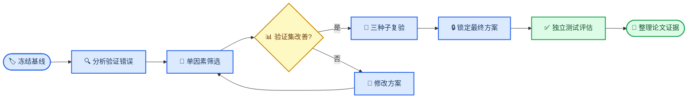

> **2026-10-28论文协作更新：** 下文为历史基线/数据交接记录。当前锁定方案最终test已完成，现行稿与80.72%主方案结果见[论文协作入口](../collaboration/START_HERE.md)。不要将历史100轮基线与当前冻结检测器直接相减。

# YOLO26 枸杞四等级基线与论文实施路线

_项目内部可复现记录与新手学习指南，更新于 2026-09-06；当前不是可投稿论文稿件。_

---

## 📋 当前结论

四等级 YOLO26n 实例分割基线已完成 100 轮训练，并首次在冻结测试集上完成评估。模型能够同时定位、分割并预测 `unqualified`、`grade_1`、`grade_2` 和 `grade_3`。

当前最重要的结果不是“模型已经可以用于最终分级”，而是已经获得了后续改进必须使用的统一基线：固定数据版本、固定训练参数、固定测试集和完整原始输出。

| 项目 | 当前值 |
| --- | ---: |
| 训练图片 | 966 |
| 验证图片 | 116 |
| 测试图片 | 129 |
| 总实例数 | 5,371 |
| 模型 | YOLO26n-seg |
| 输入尺寸 | 640 × 640 |
| 训练轮数 | 100 |
| batch | 8 |
| 随机种子 | 20260906 |
| 测试 Mask mAP50 | 0.821 |
| 测试 Mask mAP50–95 | 0.678 |

> 📌 **结论边界：** 当前只有一个随机种子的基线结果，不能据此声称新方法优于 YOLO26，也不能据此声称等级标签代表客观行业等级。

## ⚙️ 实验配置与复现

### 环境

| 项目 | 版本或型号 |
| --- | --- |
| 操作系统 | Windows |
| Python | 3.12.13 |
| Ultralytics | 8.4.117 |
| PyTorch | 2.13.0+cu130 |
| OpenCV | 5.0.0 |
| GPU | NVIDIA GeForce RTX 5070 Laptop GPU 8 GB |

PyTorch 官方说明指出，即使随机种子相同，也不能保证跨版本、跨平台或 CPU/GPU 的结果完全一致，因此论文必须同时记录软件版本、硬件和种子，而不能只记录训练命令。[^1]

### 数据和权重入口

| 用途 | 路径 |
| --- | --- |
| 数据配置 | `data/grading_four_class_v3/data.yaml` |
| 数据说明 | `data/grading_four_class_v3/README.md` |
| 训练脚本 | `scripts/train_grading_baseline.ps1` |
| 测试脚本 | `scripts/evaluate_grading_test.ps1` |
| 最佳权重 | `models/experiments/yolo26n_seg_grading4_baseline_seed20260906/weights/best.pt` |
| 训练曲线 | `models/experiments/yolo26n_seg_grading4_baseline_seed20260906/results.png` |
| 测试报告 | `outputs/reports/yolo26n_seg_grading4_baseline_seed20260906_test/` |

最佳权重 SHA-256：

```text
0A6DE467B53FCF5E6F65AE0DF6CB5196590BB5C25C2E218EB14452CDF5D28623
```

### 训练命令

在项目根目录运行：

```powershell
powershell.exe -NoProfile -ExecutionPolicy Bypass `
  -File ".\scripts\train_grading_baseline.ps1"
```

新实验训练期间若意外中断，可在清理检查点前从该实验自动生成的 `last.pt` 恢复：

```powershell
$env:YOLO_CONFIG_DIR = ".\environment\ultralytics_config"
& ".\.venv\Scripts\yolo.exe" segment train resume `
  "model=.\models\experiments\新实验名\weights\last.pt"
```

已完成的基线为控制项目体积只长期保留 `best.pt`，其 `last.pt` 已在项目交接清理时删除。

冻结测试集的评估命令：

```powershell
powershell.exe -NoProfile -ExecutionPolicy Bypass `
  -File ".\scripts\evaluate_grading_test.ps1" `
  -Model ".\models\experiments\yolo26n_seg_grading4_baseline_seed20260906\weights\best.pt"
```

Ultralytics 将实例分割的 Box 指标与 Mask 指标分别输出，`mAP50–95` 是多个 IoU 阈值上的平均结果，适合比只看 `mAP50` 更严格地评价轮廓质量。[^2]

## 📊 基线结果

### 整体结果

| 划分 | Box P | Box R | Box mAP50 | Box mAP50–95 | Mask mAP50 | Mask mAP50–95 |
| --- | ---: | ---: | ---: | ---: | ---: | ---: |
| val | 0.696 | 0.794 | 0.813 | 0.659 | 0.813 | 0.676 |
| test | 0.730 | 0.838 | 0.821 | 0.669 | 0.821 | 0.678 |

### 测试集分类别结果

| 类别 | 实例 | Precision | Recall | Mask mAP50 | Mask mAP50–95 |
| --- | ---: | ---: | ---: | ---: | ---: |
| unqualified | 25 | 0.355 | 0.960 | 0.654 | 0.522 |
| grade_1 | 126 | 0.816 | 0.905 | 0.910 | 0.769 |
| grade_2 | 167 | 0.791 | 0.748 | 0.776 | 0.645 |
| grade_3 | 258 | 0.956 | 0.740 | 0.945 | 0.776 |

完整数字保存在 `baseline_metrics.csv` 和 `baseline_summary.json`。

### 应怎样理解这些结果

- `unqualified` 的 Recall 为 0.960，说明测试集中人工标为不合格的实例大多被找出
- `unqualified` 的 Precision 只有 0.355，说明模型将较多合格果误报为不合格
- `grade_1` 和 `grade_2`、`grade_2` 和 `grade_3` 的混淆较明显，符合连续尺寸规则在边界附近难以区分的特点
- `grade_3` Precision 很高但 Recall 较低，说明模型一旦判为三级通常较可信，但仍有三级实例被分到其他等级
- 测试集不合格实例只有 25 个，这一类别的指标不够稳定，必须报告样本量并在最终实验中给出不确定性

混淆矩阵的行表示预测类别、列表示真实类别。当前矩阵显示主要错误集中在相邻等级，同时存在由其他等级进入 `unqualified` 的误报。

> ⚠️ **不要做的事：** 不要根据 test 的结果反复调超参数、类别阈值或挑选模型。改进方案只能在 train 上学习、在 val 上选择，最终方案锁定后再对 test 评估。

## 🔄 下一步实验流程



### 第一步：建立验证集错误清单

对 val 中每个真实实例和预测实例进行匹配，输出：

- 真实等级和预测等级
- 预测置信度
- Mask IoU
- 是否漏检或重复检测
- 是否为相邻等级错误
- 是否将合格果误判为不合格
- 是否与果梗缺失、腐烂、果体很小或光照变化有关

这一步只分析 val。测试集现有结果作为基线归档，不用于选择下一组参数。

### 第二步：先做低成本单因素实验

| 编号 | 只改变的因素 | 目的 | 建议设置 |
| --- | --- | --- | --- |
| E0 | 无 | 当前基线 | 640、YOLO26n、默认增强 |
| E1 | 输入分辨率 | 保留小果、果梗和腐烂细节 | 960，batch 4–8 |
| E2 | 颜色增强 | 避免增强破坏腐烂颜色，同时适应跨天光照 | 降低 `hsv_s`、`hsv_v` |
| E3 | 初始化权重 | 利用已训练的单类枸杞分割能力 | 从旧 `best.pt` 微调四类 |
| E4 | 模型容量 | 判断 YOLO26n 是否欠拟合 | YOLO26s-seg、640 |
| E5 | 官方训练优化器 | 比较 `AdamW` 与 YOLO26 配方 | `optimizer=MuSGD` |

当前基线的 `optimizer=auto` 实际选择了 AdamW，而官方 YOLO26 训练配方使用 MuSGD，因此 E5 是合理的独立对照，而不是默认假设 MuSGD 一定更好。[^3]

当前默认颜色增强为 `hsv_s=0.7`、`hsv_v=0.4`。由于腐烂判断依赖褐色、黑色等局部颜色，过强颜色扰动可能破坏有用线索；但跨天光照又需要一定光照增强。因此 E2 应比较“默认增强”和“较温和颜色增强”，而不是简单全部关闭。Ultralytics 官方文档列出了 HSV、尺度、平移和 Mosaic 等增强参数及其用途。[^4]

### 第三步：再做真正的算法改进

推荐的论文主线不是随意叠加注意力模块，而是围绕现有分级逻辑设计一个有依据的层次化模型：

1. 第一分支判断 `unqualified` 与“合格”
2. 第二分支只对合格果学习 `grade_1 → grade_2 → grade_3` 的有序关系
3. 分割分支继续输出单果 Mask
4. 可选辅助分支学习果梗存在性，帮助执行“缺梗三级”规则
5. 损失函数对跨两级错误给予高于相邻等级错误的代价

这个方向与标签生成逻辑一致，也直接针对当前问题：不合格类误报多、相邻等级混淆明显。实现前应先完成 E1–E5，确认问题不是仅靠分辨率或训练设置即可解决。

## 🧪 最终论文实验设计

### 必须保留的公平条件

- 所有方法使用同一个 `grading_four_class_v3`
- 所有方法使用同一个 train/val/test 划分
- 所有方法使用相同评价脚本和置信度策略
- 基线和改进模型都至少运行 3 个随机种子
- 用 val 选模型和超参数，不用 test 调参
- 最终同时报告均值、标准差和单次测试样本量
- 记录失败实验，而不是只留下最好的一次

### 建议对比组

| 组别 | 作用 |
| --- | --- |
| YOLO26n-Seg 640 | 当前标准基线 |
| YOLO26n-Seg 960 | 分辨率对照 |
| YOLO26s-Seg 640 | 容量对照 |
| YOLO26n-Seg 温和颜色增强 | 光照与颜色增强对照 |
| YOLO26n-Seg 单类权重迁移 | 领域预训练对照 |
| 改进模型完整版本 | 主方法 |
| 改进模型去掉每个新增模块 | 消融实验 |

### 应报告的指标

| 指标 | 回答的问题 |
| --- | --- |
| Box mAP50–95 | 定位框是否准确 |
| Mask mAP50–95 | 轮廓是否准确 |
| 每类 Precision | 该等级预测中有多少是真的 |
| 每类 Recall | 真实该等级中找回多少 |
| 每类 F1 | Precision 与 Recall 的平衡 |
| 混淆矩阵 | 各等级具体混到哪里 |
| 宏平均 F1 | 避免多数类支配总体结果 |
| 严重等级误判率 | 是否发生一级与三级等跨级错误 |
| 参数量与 GFLOPs | 模型规模 |
| 推理时间 | 实际部署速度 |

Ultralytics 的验证接口可以分别访问 Box 和 Mask 的 mAP，并输出 PR、P、R、F1 曲线和预测图。[^2][^5]

## ✍️ 论文需要准备的材料

### 建议研究问题

- RQ1：YOLO26 能否同时完成多颗枸杞实例分割与四等级识别？
- RQ2：分辨率、颜色增强和领域预训练分别怎样影响等级识别？
- RQ3：层次化不合格筛查与有序等级学习能否降低不合格误报和跨级错误？

### 方法章节应写清楚

- 图片采集设备、拍摄日期范围、距离、背景和光照条件
- 多天拍摄造成的光照变化及处理方法
- 原始图片数、实例数和四类数量
- train/val/test 的划分原则及防止来源泄漏的方法
- 腐烂人工复核、果梗复核和等级边界审核流程
- 18 项可解释特征的定义和计算方法
- 没有可靠 `px/mm` 标定，因此尺寸仍以像素报告
- 四等级标签的形成规则及人工参与范围
- 模型版本、预训练权重、输入尺寸、batch、epochs、优化器和增强参数
- 随机种子、硬件、软件版本、早停和最佳模型选择规则
- 评价指标、实例匹配方式和统计方法

### 结果章节建议表图

| 编号 | 内容 | 当前状态 |
| --- | --- | --- |
| 表 1 | 数据集划分和类别分布 | 已有 |
| 表 2 | 18 项特征定义与单位 | 已有基础 |
| 表 3 | 基线与改进模型总体指标 | 待改进实验 |
| 表 4 | 四个类别的 P、R、F1、AP | 已有基线 |
| 表 5 | 消融实验 | 待完成 |
| 图 1 | 数据处理与分级流程 | 可由本项目流程生成 |
| 图 2 | Mask、长短径、疑似损伤示例 | 已有质检素材 |
| 图 3 | 特征分布和 PCA | 已有 |
| 图 4 | 训练曲线 | 已生成 |
| 图 5 | 测试集混淆矩阵 | 已生成 |
| 图 6 | 正确、相邻误判、严重误判案例 | 待错误审计 |
| 图 7 | 改进模型结构 | 待确定主方法 |

### 需要保留的原始证据

- 数据版本和审计 JSON
- 人工审核表、审核规则和分歧处理记录
- 每次训练的 `args.yaml`、`results.csv`、权重和图表
- 每次测试的预测 JSON、混淆矩阵和指标表
- 代码版本、依赖版本、GPU 型号和随机种子
- 每张论文图对应的原始 CSV 和生成代码
- 被排除的 74 张图片及排除原因

## ⚠️ 当前研究局限

### 标签不是独立行业真值

一级、二级和三级主要由冻结的尺寸/形态规则产生，缺梗覆盖为三级，不合格主要来自人工腐烂标注。因此深度模型当前学习的是“复现已制定的项目分级规则”，不能直接写成“发现了客观最优等级标准”。

论文应明确区分：

- 分级标准制定：来自特征统计、人工规则和复核
- 等级自动识别：深度模型学习复现该标准
- 模型改进：在同一标签标准下提高识别效果

### 像素尺度限制

没有实物和标定板，无法恢复可靠毫米尺寸。如果相机距离和分辨率不完全一致，像素面积可能同时反映真实大小和拍摄尺度。论文需要如实报告这一限制，不应把像素直接表述为毫米。

### 光照与颜色限制

图片跨多天拍摄，照明不完全一致。合格果等级没有使用全局颜色阈值是合理的，但不合格腐烂识别仍会受到颜色和高光影响。应按拍摄批次检查数据划分，防止模型把某一天的色调当成等级线索。

### 类别不平衡与样本代表性

测试集只有 25 个不合格实例，且总体数据以较好果实为主。最终论文需要报告类别分布、置信区间或自助法不确定性，并限制结论的外推范围。

### 测试标签的形成方式

测试集中一部分实例经过双人一致审核和负责人裁决，另一部分按冻结规则处理。论文应报告各部分数量，避免让读者误以为全部 576 个测试实例均由多人逐个独立定级。

## 🎓 建议学习顺序

### 第一阶段：会运行和看懂输出

1. Python 虚拟环境、路径和包版本
2. YAML 数据配置和 YOLO 标签格式
3. train、val、test 的区别
4. `best.pt`、`last.pt`、`args.yaml`、`results.csv` 的用途
5. 如何从检查点恢复训练

### 第二阶段：理解指标

1. Bounding box 与实例 Mask
2. IoU 与 Mask IoU
3. TP、FP、FN
4. Precision、Recall、F1
5. PR 曲线、AP、mAP50、mAP50–95
6. 混淆矩阵和类别不平衡

### 第三阶段：理解深度学习训练

1. 卷积、特征图和感受野
2. Backbone、Neck、Head
3. 损失函数和反向传播
4. 优化器、学习率、batch 和 epochs
5. 过拟合、欠拟合和数据增强
6. 迁移学习和冻结/解冻

### 第四阶段：理解 YOLO26

YOLO26 官方资料介绍了端到端无 NMS 推理、轻量预测头、STAL、Progressive Loss 和 MuSGD 等设计。[^6][^7] 学习时建议同时对照本地 `args.yaml` 和模型打印结构，区分“官方模型具备的机制”和“本次训练实际采用的参数”。

### 第五阶段：能做模型改进

1. 阅读 Ultralytics 模型 YAML 和模块注册方式
2. 阅读 `Segment26` 头和对应损失代码
3. 学习特征金字塔和小目标检测
4. 学习有序分类与代价敏感学习
5. 学习多任务学习和辅助损失
6. 学习消融实验、重复种子和统计不确定性

### 推荐官方学习入口

- YOLO26 模型说明与架构概览[^6]
- YOLO26 实例分割训练和验证[^2]
- YOLO26 官方训练配方[^3]
- Ultralytics 数据增强说明[^4]
- Ultralytics 验证与指标说明[^5]
- PyTorch 可复现性说明[^1]

## ✅ 近期执行清单

- [x] 完成 YOLO26n 四等级基线训练
- [x] 完成冻结测试集首次评估
- [x] 保存机器可读基线指标和权重哈希
- [ ] 生成验证集逐实例错误审计表
- [ ] 制作错误案例检查图
- [ ] 运行 960 分辨率单因素实验
- [ ] 运行温和颜色增强实验
- [ ] 比较单类枸杞权重迁移
- [ ] 比较 YOLO26s 模型容量
- [ ] 确定层次化/有序分级改进方案
- [ ] 对基线与最终方法运行至少 3 个随机种子
- [ ] 锁定最终方法后进行正式 test 对比
- [ ] 完成消融、速度和模型复杂度实验
- [ ] 建立论文证据表、图表清单和引用库

## 🔗 参考资料

[^1]: PyTorch. (2026). “Reproducibility.” _PyTorch Documentation_. https://docs.pytorch.org/docs/stable/notes/randomness.html

[^2]: Ultralytics. (2026). “Instance Segmentation with Ultralytics YOLO.” _Ultralytics Documentation_. https://docs.ultralytics.com/tasks/segment/

[^3]: Ultralytics. (2026). “YOLO26 Training Recipe.” _Ultralytics Documentation_. https://docs.ultralytics.com/guides/yolo26-training-recipe/

[^4]: Ultralytics. (2026). “Data Augmentation using Ultralytics YOLO.” _Ultralytics Documentation_. https://docs.ultralytics.com/guides/yolo-data-augmentation/

[^5]: Ultralytics. (2026). “Model Validation with Ultralytics YOLO.” _Ultralytics Documentation_. https://docs.ultralytics.com/modes/val/

[^6]: Ultralytics. (2026). “Ultralytics YOLO26.” _Ultralytics Documentation_. https://docs.ultralytics.com/models/yolo26/

[^7]: Jocher, G., Qiu, J., Liu, M., Lyu, S., Akyon, F. C., and Kalfaoglu, M. E. (2026). “Ultralytics YOLO26: Unified Real-Time End-to-End Vision Models.” _arXiv_. https://arxiv.org/abs/2606.03748

---

_本记录中的项目数值来自本地训练与审核文件；外部方法说明仅使用上列官方文档和原始 YOLO26 论文。任何投稿版本均需由作者逐项核对数据、引用、作者贡献和期刊要求。_
