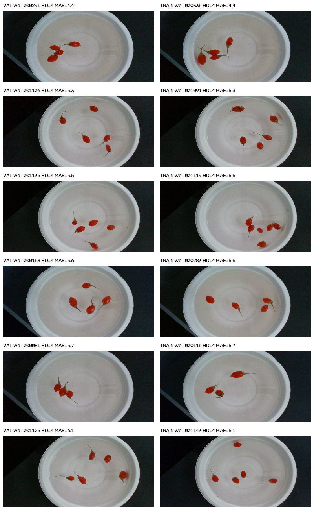
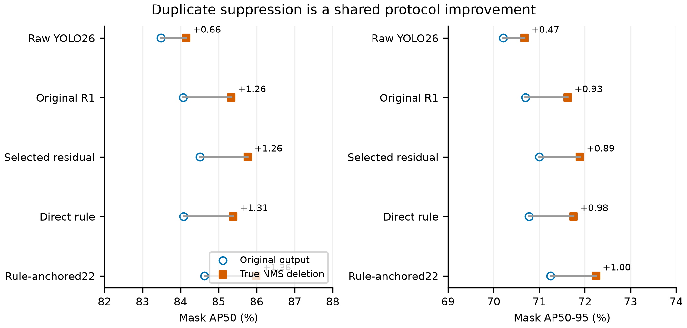
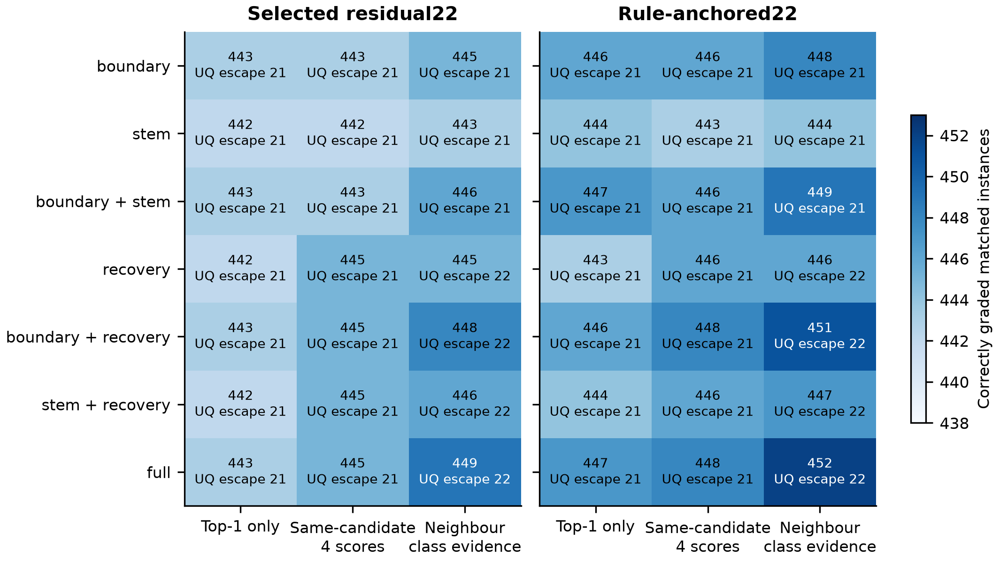
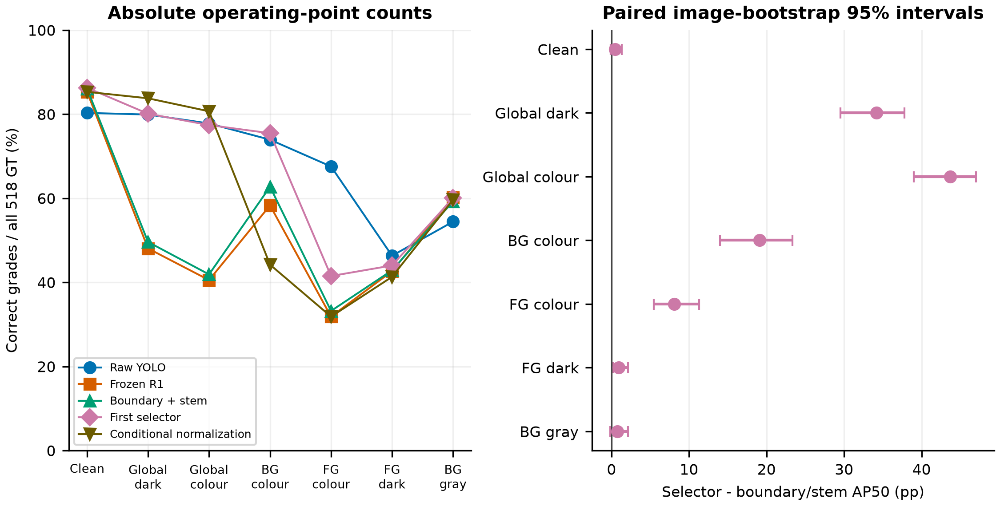
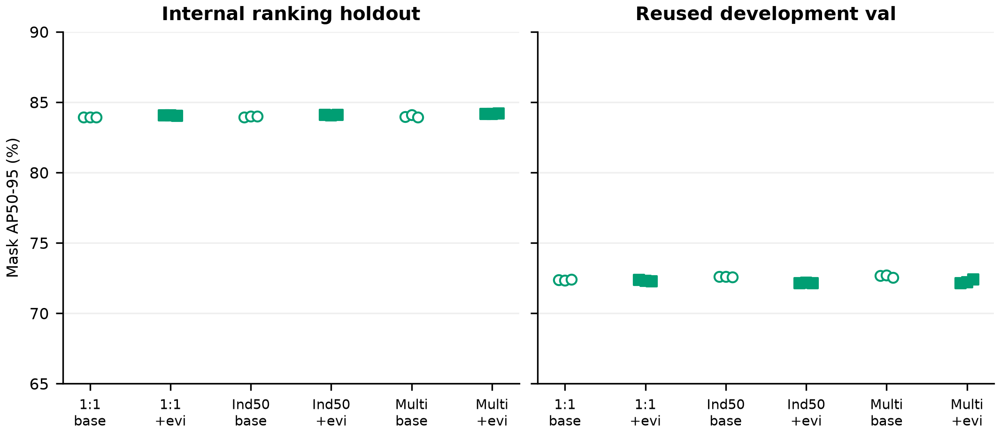
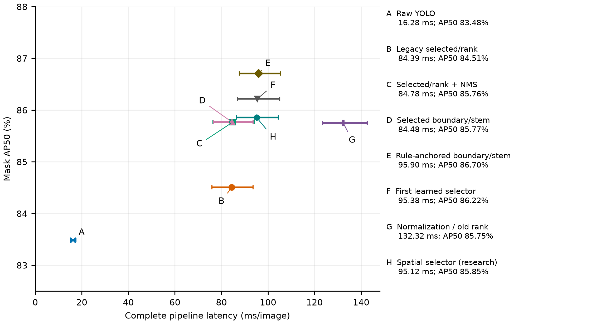
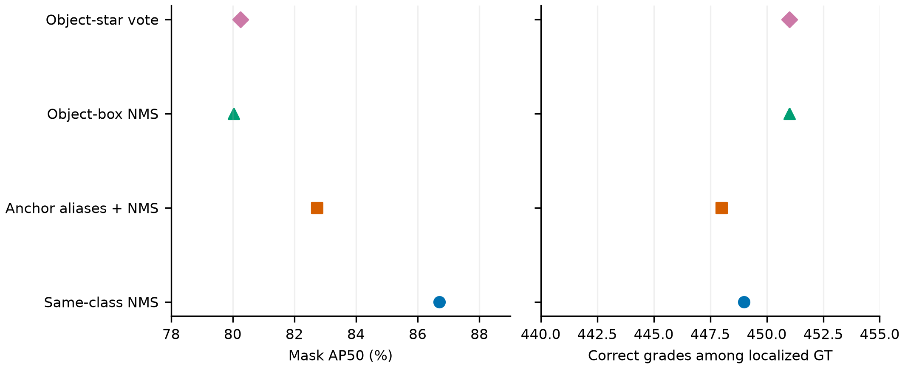
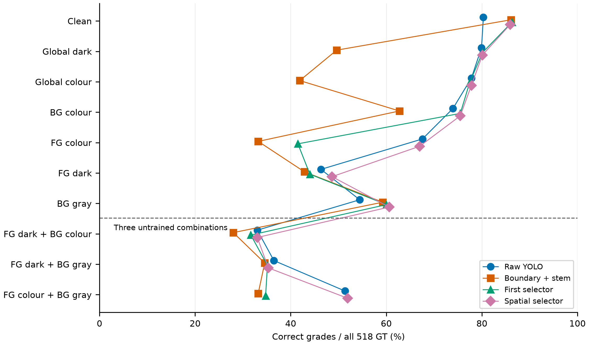
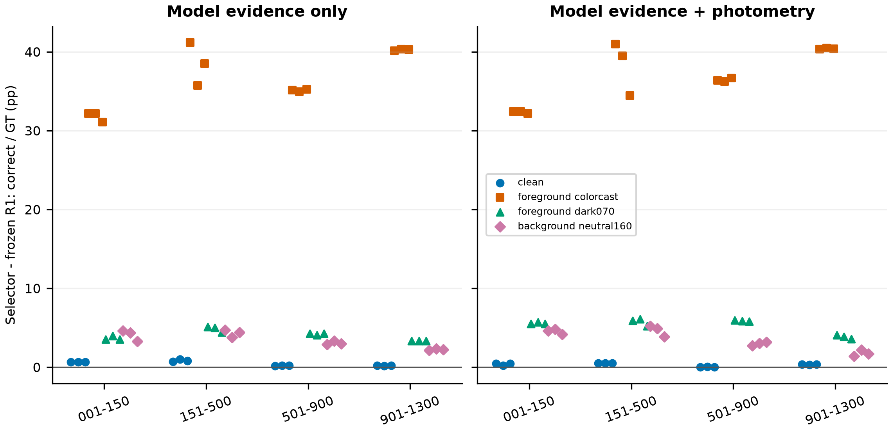
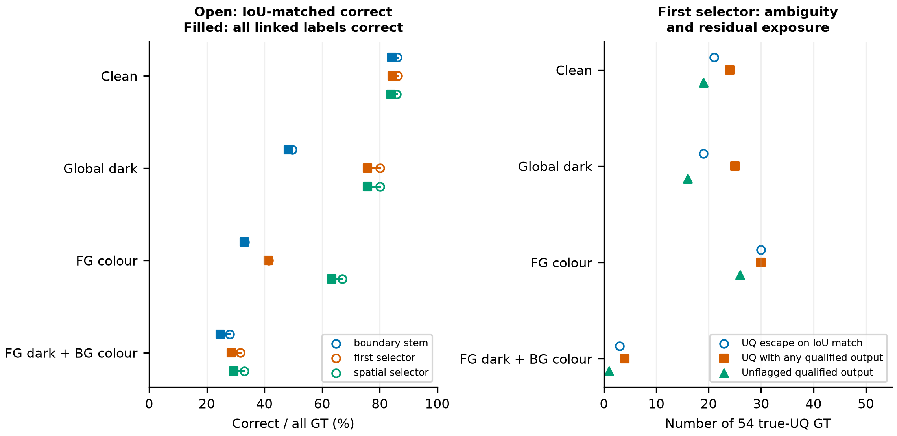

# 联合决策、真实去重与空间鲁棒性：2026-10-24 实验报告

本轮执行用户“进一步实验直到当前5h额度用完”的授权。研究仅使用train/val，未调用test；原有模型、标签、缓存与生产入口均保留。新实验放在`joint_pipeline_20261024`独立目录。本报告属于开发研究，不能写成独立测试集最终结论。

## 1. 可采取的结论

已完成126次新优化拟合：排序器54次、第一版分支选择器36次、空间增强选择器12次、跨来源嵌套审计24次。没有重训检测器或视觉编码器；其余矩阵和重采样属于评估次数，不能累计成“训练实验”。

应保留真正删除重复候选、同一次前向的类别分数追溯和独立研究推理入口。正常图上最稳妥的后续研究起点是Selected22边界+果梗方案：446/500，AP50约85.77%。但同等去重的既有Selected22已达到约85.76%，新决策的AP额外收益区间跨零，不能把全部提高归为新模块贡献。

第一版选择器为447/500，能大幅缓解部分合成全图光照/背景干预，但在仅前景偏色上为215/484，存在大幅失效。空间增强把该条件提高到347/484，却把正常图降到445/500，未通过预先设定的正常图至少446例保护线，因此不替换主方案。固定的Rule-anchored22边界+果梗为449/500、AP50约86.70%，成本也更高。Direct Rule同样边界+果梗为450/500、AP50约86.52%，本轮未对该配置重测整链延迟。含不合格恢复的rr22 452/500及Direct Rule 453/500仍伴随误放风险，不设为默认。

## 2. 数据、协议与选择边界

原train966图、4277GT；val116图、518GT。内部头划分为773/193图，沿用原文件；排序器沿用自己的校准划分。重放得到头留出837个定位实例，原报告836的差异仍未从历史文件解释；原模型/教师已见过原train，内层留出只隔离新头拟合，不是全系统未见数据。

检测固定640、FP32、conf=.001、max_det300、retina_masks=True；操作点按原detector conf≥.25。同类去重IoU=.7，并采用raw高置信范围优先，避免低raw框被旧rank抬高后压掉高raw框。该优先顺序是明确的协议选择，不是标准NMS的通用定义。真实keep_indices同步切片框、掩膜、类别、分数及IoU矩阵，再重算匹配/AP。

AP使用全部518GT；“正确/定位”使用存活高raw置信预测与GT的mask-IoU≥.5定位匹配；“正确/全部GT”把漏检计入分母。类别敏感TP和定位匹配后正确数可以不同，不能混用。固定原500实例标签端点另存，不代替最终输出。连续评分目标来自既有形态规则，不等同于物理毫米或独立专家金标准。

后续家族在train内部选择并固定种子20261024，另两个种子20261025/26都报告。没有按val最好种子挑选。然而整个项目以及本轮序贯修改都已有val反馈；后续登记不等于对历史选择过程的真正预注册。

## 3. 正常图完整对照

| 方法 | 正确/定位 | 正确/518 GT % | AP50 % | AP50–95 % | 不合格误放 | 合格误拒 | ms/图 |
| --- | --- | --- | --- | --- | --- | --- | --- |
| 原生YOLO，无追加去重 | 416/500 | 80.31 | 83.4817 | 70.2097 | 21 | 10 | 16.28 |
| 原生YOLO，真实同类去重 | 416/500 | 80.31 | 84.1466 | 70.6770 | 21 | 10 | 未测 |
| Original R1/自有rank，原输出 | 439/500 | 84.75 | 84.0669 | 70.6933 | 21 | 10 | 未测 |
| Original R1/自有rank，同等去重 | 439/500 | 84.75 | 85.3317 | 71.6244 | 21 | 10 | 未测 |
| Selected22/自有rank，原输出 | 442/500 | 85.33 | 84.5066 | 70.9977 | 21 | 10 | 84.39 |
| Selected22/自有rank，同等去重 | 442/500 | 85.33 | 85.7643 | 71.8891 | 21 | 10 | 84.78 |
| Direct Rule/自有rank，同等去重 | 443/500 | 85.52 | 85.3848 | 71.7501 | 21 | 10 | 未测 |
| Direct Rule，边界+果梗/邻域 | 450/500 | 86.87 | 86.5249 | 72.5598 | 21 | 10 | 未测 |
| Direct Rule，含加权不合格恢复 | 453/500 | 87.45 | 86.8250 | 72.8009 | 22 | 5 | 未测 |
| Rule-anchored22/自有rank，同等去重 | 443/500 | 85.52 | 85.9871 | 72.2416 | 21 | 10 | 未测 |
| Selected22，边界+果梗/邻域 | 446/500 | 86.10 | 85.7695 | 71.9221 | 21 | 10 | 84.48 |
| Rule-anchored22，边界+果梗/邻域 | 449/500 | 86.68 | 86.7046 | 72.7225 | 21 | 10 | 95.90 |
| Rule-anchored22，含加权不合格恢复 | 452/500 | 87.26 | 87.0036 | 72.9633 | 22 | 5 | 未测 |
| 第一版学习选择器，固定seed24 | 447/500 | 86.29 | 86.2167 | 72.3382 | 21 | 10 | 95.38 |
| 空间增强选择器，固定seed24 | 445/500 | 85.91 | 85.8540 | 72.0079 | 21 | 10 | 95.12 |
| 既有条件归一化/移植旧rank | 442/500 | 85.33 | 85.7514 | 71.8780 | 21 | 10 | 132.32 |

不合格误放统计GT class0被分到合格等级；合格误拒统计已定位的真合格被分class0。二者不把未定位GT悄悄算成正确。全量混淆与漏检在原始表中保留。ms为最终同轮测量，空格项未测，不能外推旧耗时。

原始YOLO26当前为end2end头，传统class-offset NMS并未在该分支执行。原始输出已有高置信同类重复10对，R1后36对，新增26对。因此碰撞真实存在，但不是“YOLO原有传统NMS必然保证被重分类破坏”。应给原生YOLO与每个旧分支同等去重对照。

## 4. 同候选四类分数与邻域类别证据

已在同一次Segment26前向、top-k前捕获候选索引和四类原始分数，对966train+116val的公共结果逐框对齐；框、类别、原conf与历史缓存一致。这为线上实现提供可追溯来源。

`raw_same_candidate`是同一候选的真实四类分数；`neighbour`是box-IoU≥.85邻域中各类最大值，缺失类填1e-4；`top1`仅保留原最高类。分数不保证和为1，两条路径均不直接称为已校准后验。邻域可能把多个候选甚至近邻物体的分数拼到一个向量里，不能称为“找回同一框完整概率分布”。

P2包含792行：6个分数源×22个证据/策略组合×3个去重协议×内部头留出/val。边界、果梗、不合格恢复均拆开。内部选择的rr22完整top1策略留出805/837、val447；不事后替换为val更好的邻域452版本。

负对照保留自身类时只打乱替代类，或打乱全部类、换取本图非重叠物体向量，30个固定随机种子，共540次确定性评估。rr22边界+果梗真实邻域449，替代类置换均值447.47（446–449），全类置换436.53，错物体433。空间/类别语义有用，但替代类额外证据收益较小，随机置换次数不是独立实验样本或p值。

## 5. 不合格恢复及排序器的否定结果

加权恢复不合格有助于总正确数，却会把真实不合格误放。缺陷logit和检测类别一致的共识门控也没有在所有干预下排除该问题。没有按已知val图ID写例外。

共识v1曾漏写创建class0赋值，测试发现后失效标记，保留原产物供审计；结论只用修复后的`consensus_v2_*`。不能把失效v1当证据。

54次排序拟合比较一对一TP50、独立TP50、跨10个IoU阈值的独立目标，以及14维基准/加4维类别证据，三种决策各3种子。分配网络同为18→16→1、321参数，但基准4列置零会减少有效自由度，不能宣称有效容量完全一致。训练只使用拟合划分标准化，早停由原校准留出决定。

| 决策 | 内部选择的家族 | 内部留出AP50–95均值/种子范围 % | val均值/种子范围 % |
| --- | --- | --- | --- |
| selected22/standard | independent_multi_iou/base14_evidence4 | 83.134（83.124–83.139） | 71.808（71.659–71.916） |
| selected22/boundary_stem | independent_multi_iou/base14_evidence4 | 84.185（84.170–84.208） | 72.240（72.124–72.403） |
| rule_anchored22/boundary_stem | independent_multi_iou/base14_evidence4 | 84.220（84.194–84.244） | 72.861（72.731–72.951） |

内部偏好的independent_multi_iou+evidence没有带来稳定val优势，保留负结果，不移植旧rank再称新策略已校准，也不改选val较优家族。

## 6. 分支选择器与空间干预

第一阶段36次：线性/40→16→1 MLP、模型证据/加17维局部光度特征、clean/成对偏好/含clean保护三种训练，固定3种子。673参数MLP的输入来自冻结图像特征、模型/候选证据与预测掩膜的局部光度；GT只在离线训练定义偏好标签，线上不参与资格判断。只在raw≥.25、原YOLO与R1均非class0且分级分歧时选择分支，保留class0门控。它选择最终等级，不能把改判称为连续尺寸评分精度提高。

第一阶段四种训练条件是正常、全图暗光、全图偏色、仅背景偏色。第二阶段12次补入仅前景偏色/暗光/背景灰三种条件，比较旧四条件和全部七条件的保护训练、两组特征、三种子。全部七条件标准化统计只用拟合图像；旧四条件对照也使用这一不含标签的标准化，检查点选择看七条件内部留出，因此该控制不是完全没有见过新条件。

合成前景由正常图预测高置信掩膜并集定义；背景为其补集。局部光度特征的包围框邻域未保证全是真背景。遮掉果梗、污染边界等都可能使标签保持假设变弱。所有条件都对实际变换图重新推理，不是修改缓存分数。七种变换都已用于第二阶段训练，只有最后三种组合在空间家族冻结后才评估。

| 条件 | YOLO+去重 | 边界+果梗 | 第一版选择器 | 空间增强选择器 | 条件归一化/raw |
| --- | --- | --- | --- | --- | --- |
| 正常图 | 416/500 | 446/500 | 447/500 | 445/500 | 442/500 |
| 全图暗光 | 414/498 | 257/498 | 415/498 | 415/498 | 434/498 |
| 全图偏色 | 403/498 | 217/498 | 401/498 | 403/498 | 418/498 |
| 仅背景偏色 | 383/492 | 325/492 | 391/492 | 391/492 | 229/492 |
| 仅前景偏色 | 350/484 | 172/484 | 215/484 | 347/484 | 165/484 |
| 仅前景暗光 | 240/484 | 222/484 | 228/484 | 252/484 | 214/484 |
| 背景灰160 | 282/487 | 307/487 | 311/487 | 314/487 | 309/487 |
| 前景暗+背景偏色 | 171/488 | 145/488 | 164/488 | 171/488 | 未运行 |
| 前景暗+背景灰 | 189/480 | 179/480 | 182/480 | 183/480 | 未运行 |
| 前景偏色+背景灰 | 266/485 | 172/485 | 180/485 | 269/485 | 未运行 |

上表按各条件重新定位，分母可变化；比较总任务效果请使用原CSV的correct_per_all_GT，统一分母518。不能从条件分母较小推断系统更准。

第一版选择器在全图暗光415/498，既有条件归一化434/498更强；但仅背景偏色选择器391/492，归一化229/492。不存在全条件占优的新模型。归一化原始置信与移植旧排序器两个版本都保留；本表用raw，旧rank版本未重新校准，不能混为一行。

空间家族内部选择后固定seed24；正常445/500未过446保护线，即使重采样区间跨零也不能事后取消点值保护线。三类未训练组合仍有严重错误，例如前景暗+背景偏色171/488、前景暗+灰背景183/480。这说明训练覆盖能缓解特定干预，却尚不能宣称解决背景捷径或真实场景域泛化。

## 7. 配对不确定性与跨来源新头审计

两轮各2000次整图配对、按四来源范围分层重采样，相同原图的所有变换使用同一抽样次数。第一轮12个对比×6个端点；第二轮24个对比×6个端点。以下均为探索性、逐项95%百分位区间，没有多重比较/选择修正；重复使用val，来源范围也未证实是独立收获批次。

| 对比 | 端点 | 点差/百分点 | 95%逐项区间/百分点 |
| --- | --- | --- | --- |
| scopeNMS − legacy | Mask_AP50 | +1.2577 | [+0.8755, +1.6650] |
| scopeNMS − legacy | correct_per_allGT | +0.0000 | [+0.0000, +0.0000] |
| boundary − scopeNMS | Mask_AP50 | +0.0051 | [-1.2582, +1.2474] |
| boundary − scopeNMS | correct_per_allGT | +0.7722 | [-0.3861, +1.9921] |
| rr_boundary − scopeNMS | Mask_AP50 | +0.9403 | [-0.4071, +2.2053] |
| rr_boundary − scopeNMS | correct_per_allGT | +1.3514 | [+0.0000, +2.8791] |
| arb_clean − base_clean | Mask_AP50 | +0.4473 | [-0.1358, +1.3503] |
| arb_clean − base_clean | correct_per_allGT | +0.1931 | [-0.3883, +0.9434] |
| arb_dark070 − base_dark070 | Mask_AP50 | +34.1807 | [+29.5159, +37.8004] |
| arb_dark070 − base_dark070 | correct_per_allGT | +30.5019 | [+25.6359, +35.2384] |

边界/果梗相对同等去重Selected的AP50点差约0.005个百分点，区间跨零。它相对旧未去重模型看起来明显提升，主要混合了共享后处理改进。不能据此写“新决策显著提高AP”。

| 固定候选对比 | 正确/全部GT点差/百分点 | 95%逐项区间 |
| --- | --- | --- |
| spatial_clean − first_clean | -0.386 | [-1.158, +0.377] |
| spatial_foreground_colorcast − first_foreground_colorcast | +25.483 | [+21.705, +29.502] |
| spatial_foreground_dark070 − first_foreground_dark070 | +4.633 | [+2.723, +6.574] |
| first_dark070 − normalization_dark070 | -3.668 | [-6.421, -0.786] |
| first_background_colorcast − normalization_background_colorcast | +31.274 | [+26.437, +36.016] |

空间候选的特定前景改善远大于正常图损失，但这不能改变正常保护线失败；正常图AP差的区间跨零也不是“等价”证明。

额外24次跨来源嵌套拟合按四个原来源范围外留，其他来源的原head_fit/head_held分别训练与选点，同图所有变换分组。只审计新选择器的跨来源适应；冻结检测器/编码器已看过这些train来源，不是全系统OOD验证。缺类来源AP只平均实际存在等级，主要跨来源端点用正确/全部GT。

| 外层来源范围 | 特征 | 正常图净正确数 | 仅前景偏色 | 仅前景暗光 | 背景灰 |
| --- | --- | --- | --- | --- | --- |
| 001-150 | 仅模型证据 | +3…+3 / 457 | +142…+147 / 457 | +16…+18 / 457 | +15…+21 / 457 |
| 001-150 | 加局部光度 | +1…+2 / 457 | +147…+148 / 457 | +25…+26 / 457 | +19…+22 / 457 |
| 151-500 | 仅模型证据 | +7…+10 / 1016 | +363…+418 / 1016 | +45…+52 / 1016 | +38…+48 / 1016 |
| 151-500 | 加局部光度 | +5…+5 / 1016 | +350…+416 / 1016 | +53…+62 / 1016 | +39…+53 / 1016 |
| 501-900 | 仅模型证据 | +2…+3 / 1383 | +483…+487 / 1383 | +56…+59 / 1383 | +40…+46 / 1383 |
| 501-900 | 加局部光度 | +0…+1 / 1383 | +501…+507 / 1383 | +80…+82 / 1383 | +38…+44 / 1383 |
| 901-1300 | 仅模型证据 | +2…+3 / 1421 | +570…+573 / 1421 | +47…+47 / 1421 | +30…+33 / 1421 |
| 901-1300 | 加局部光度 | +4…+5 / 1421 | +573…+575 / 1421 | +51…+58 / 1421 | +20…+31 / 1421 |

表中范围是三个优化种子的净正确数极值，不是置信区间。全部七条件和逐类AP在source_nested_metrics.csv，不能只摘正结果。

## 8. 同果一致性与可操作输出

物理果实不是框IoU簇。精确同候选合并、跨类object NMS(.85)、星形投票均评估，合计120行。固定rr22边界策略，同类NMS为449正确、AP50 86.7046%；跨类object NMS可到451正确，却把AP50降到80.0308%，不能仅凭分级计数部署。

纯GT无关的跨类冲突复核标记可在研究入口输出。rr22边界策略13/500匹配GT对应冲突组（2.6%），只覆盖51错中的5错，自动区仍46/487错，约9.45%；不能称为全面可靠性保证。IoU定位匹配449正确，而按同果最大置信类可得451，说明“实例分级准确率”依赖操作定义。主表仍固定定位匹配协议，另存置信决策审计。

新入口`joint_pipeline_inference_20261024.py`为可选研究CLI，支持选定评分源、证据、去重策略与显式选择器checkpoint，JSON输出原conf、用于AP的rank、连续分数、分支来源、选择器原始分数和冲突复核标记。选择器分数未校准；改变最终等级时保留原连续评分与来源，不能声称二者语义完全一致。可视化仅画raw≥.25，JSON仍保留AP低阈值候选。原生产入口未改。

## 9. 整链成本与实现一致性

最终960次计时=24图×5次×8分支，固定最终源码哈希；每分支独立完成推理、预热3图、随机执行顺序、CUDA仅在整链前后同步。磁盘解码统一排除，包含原全量ROI编码、掩膜与后处理；不包括初始化/首次探针附着冷启动。重复计时不视作独立图像。最初720次测量原样保留，主文仅用final960。

| 分支 | 平均ms/图 | 相对旧Selected/rank增量ms | 95%配对图像区间 |
| --- | --- | --- | --- |
| conditional_normalization | 132.320 | +47.928 | [+46.021, +49.624] |
| first_arbitration | 95.385 | +10.993 | [+9.974, +11.913] |
| legacy_selected_rank | 84.392 | +0.000 | [+0.000, +0.000] |
| raw_YOLO | 16.283 | -68.109 | [-76.257, -60.928] |
| rr22_boundary_stem | 95.905 | +11.513 | [+10.712, +12.271] |
| selected_boundary_stem | 84.479 | +0.087 | [-0.368, +0.488] |
| selected_rank_scopeNMS | 84.780 | +0.388 | [-0.216, +0.946] |
| spatial_arbitration | 95.119 | +10.727 | [+9.697, +11.650] |

第一版选择器增加约10.99ms，不能写成零开销。新阶段与历史54.51ms具有不同运行实现/成本范围，不混入同一公平表。高置信ROI子集编码和保持batch数但替换低置信ROI的优化都未通过预设数值容差（尽管观察标签未变），失败状态已封存，最终计时与入口均使用全ROI路径。未放宽容差后重新宣称等价。

原图实时推理与缓存/策略的7配置×116图=812例通过，框、类别、keep、置信与保留polygon一致，评分最大绝对差7.63e-6，果梗差0。七条件mask-IoU重建另812例完全一致，面积一致。7项回归测试通过，覆盖空预测、真实删除、低置信压制、类别碰撞、索引对齐与模式保护等。

## 10. 交付、建议与尚未解决的问题

完整数据保存在`outputs/reports/joint_pipeline_20261024`，新头checkpoint在`models/experiments/joint_pipeline_20261024`，9幅图有PNG300dpi/SVG/PDF及表格来源哈希。图05已使用final960计时并通过引线区分重叠点，图07保留未训练组合失败，图08明确仅新头跨来源审计。具体期刊版式未指定，不认证投稿合规。

建议研究集成优先真实去重与可追溯类别证据，保留简单边界/果梗候选作干净对照；将学习选择器作为鲁棒性研究分支。当前不替换主模型，不启用不合格恢复默认，不按最佳val数封存主方案。若后续继续，应先定义实际部署的单果唯一输出与不合格代价，获取独立物理果实/采集批次的正常及真实光照变化样本；在这些新数据上验证冻结方案，不能用本轮val继续证明外部泛化。

历史讨论中467/500之类的“可达上限”只能限定于当时冻结门控、候选队列与匹配规则。改变门控、数据或操作定义都会改变该值，不能称为视觉系统的物理边界。6762条七条件训练记录也只是966张原train图的重复变换，不是新增6762个独立采集样本。

本轮可靠度头验证的是候选排序目标与最终AP；BCE训练、sigmoid输出或AP提高均不足以单独证明后验概率校准。现阶段论文宜使用reliability ranking/branch arbitration的准确表述。若沿用Reliability Calibration作为核心贡献，还需要定义概率事件，并在真正独立的校准/评价数据上检验可靠图和适当评分规则；本报告没有把未做的校准实验写成已完成。

复现步骤、选定权重、文件哈希和交付检查见产物目录的`README.md`、`delivery_audit.json`及`reproduction_manifest.json`。历史数据和基础权重为本项目依赖，不随轻量复现包全部复制。

## 11. 额外输出风险审计：匹配正确不保证所有输出一致

在查看跨类输出后登记的适应性诊断，未训练新模型、未调阈值。47个条件/方法组合各检查none、任意跨类冲突、不合格冲突3条固定复核规则，共141行。此处用真实保留raw≥.25预测，和运行入口完全相同的两两box-IoU≥.85规则标记复核。标记不读取GT。

离线为每个GT收集mask-IoU≥.5的全部高置信输出：若所有关联等级都等于GT，才计入严格一致正确；真class0只要关联任意合格等级，就记录一次‘存在合格输出’。它允许一个预测关联多个GT，不是官方AP、真实物理果实分组或最终唯一决策，也没有覆盖未关联GT的背景误报；不能把它悄悄替换主指标。漏检和复核项不算正确。

| 条件 | 方法 | IoU匹配正确 | 所有关联输出一致正确 | 匹配口径不合格误放 | 真不合格有任意合格输出 | 移除冲突标记后仍有合格输出 | 高置信输出复核比例 % |
| --- | --- | --- | --- | --- | --- | --- | --- |
| 正常图 | boundary_stem | 446 | 436 | 21 | 24 | 19 | 5.83 |
| 正常图 | first_selector | 447 | 437 | 21 | 24 | 19 | 5.83 |
| 正常图 | spatial_selector | 445 | 435 | 21 | 24 | 19 | 5.83 |
| 全图暗光 | boundary_stem | 257 | 250 | 19 | 25 | 17 | 5.47 |
| 全图暗光 | first_selector | 415 | 392 | 19 | 25 | 16 | 15.21 |
| 全图暗光 | spatial_selector | 415 | 392 | 19 | 25 | 16 | 15.21 |
| 仅前景偏色 | boundary_stem | 172 | 171 | 30 | 30 | 27 | 2.04 |
| 仅前景偏色 | first_selector | 215 | 214 | 30 | 30 | 26 | 2.85 |
| 仅前景偏色 | spatial_selector | 347 | 328 | 30 | 30 | 26 | 12.04 |
| 前景暗+背景偏色 | boundary_stem | 145 | 128 | 3 | 4 | 1 | 20.92 |
| 前景暗+背景偏色 | first_selector | 164 | 148 | 3 | 4 | 1 | 22.87 |
| 前景暗+背景偏色 | spatial_selector | 171 | 152 | 3 | 4 | 1 | 23.19 |

正常图第一版选择器447例匹配正确、437例严格输出一致；真不合格GT共54个，匹配口径误放21个，但有任意合格输出24个。暂缓处理全部跨类冲突标记输出后仍有19个真不合格关联未标记合格输出。全图暗光该选择器415匹配正确，但严格一致392；仅前景偏色的空间选择器347匹配正确、严格一致328。复核比例按输出框计算，不能与先前按匹配GT计的2.6%混为一个工作量指标。

3个因果反例检查均通过：高IoU正确拒绝旁存在合格孪生框时必须计暴露；不同果实的不同等级不会单凭类不同触发复核；低置信替代框不纳入操作输出、漏检保留在全部GT分母。它们补充原7个回归检查，共10项。结果进一步支持先定义单果唯一输出与不合格处置规则，再做部署验证；目前没有把人工复核视为已经纠错。

## 12. 相同置信度对照、划分筛查与空输出探针

主方案使用raw置信，旧参考使用其原rank。为避免把两者差异混称为纯融合收益，补充登记以下相同置信/原rank的全部6个配对对比，各2000次按来源分层整图重采样，seed20261026。重复端点与先前区间略有差异来自抽样种子；没有新增独立数据，也未做多重或适应性选择修正。

| AP50对比 | 点差/百分点 | 95%逐项区间 |
| --- | --- | --- |
| selected22_boundary_raw − selected22_standard_raw | +1.3871 | [-0.3142, +3.2709] |
| selected22_standard_oldrank − selected22_standard_raw | +1.3820 | [+0.5475, +2.2341] |
| selected22_boundary_raw − selected22_standard_oldrank | +0.0051 | [-1.1890, +1.2766] |
| rule_anchored22_boundary_raw − rule_anchored22_standard_raw | +2.0186 | [+0.4187, +3.4714] |
| rule_anchored22_standard_oldrank − rule_anchored22_standard_raw | +1.3011 | [+0.5353, +2.1606] |
| rule_anchored22_boundary_raw − rule_anchored22_standard_oldrank | +0.7175 | [-0.4041, +1.6194] |

在相同raw置信下，rr22边界+果梗比rr22标准门控AP50高2.0186个百分点，探索性区间[0.4187,3.4714]；但比rr22既有原rank参考仅高0.7175个百分点，区间[−0.4041,1.6194]。Selected同raw对照增1.3871个百分点，区间跨零；既有rank本身贡献约1.382个百分点。因此‘优于未经排序的标准门控’与‘优于已有较强整流程’是不同命题，不能替换。

对966train+116val的实际原图重新计算SHA256，全部与缓存来源一致，跨train/val字节完全相同图像0对。32×32灰度DCT低8×8中位数hash筛查的最近跨划分距离最小4/64、中位8/64，无零距离；保存每张val最接近的3张train和固定前6对拼图。查看这6对发现盘子/背景相似、果实布局存在变化。该粗筛不能确定相同物理果实是否跨划分，不能排除同拍摄批次/相邻帧共享。未据此剔除val样本或改划分，后续独立采集仍必要。

另用黑、灰160、白的360×640合成帧，对raw、边界、含恢复、两版选择器、条件归一化6配置做18次实际API探针；本次都返回空输出、索引/多边形/元数据对齐，未出现GT字段。它验证空预测路径可运行，不是现实背景误报率基准。来源：confidence_contrast_intervals.csv、split_screen_status.json、split_nearest_pairs.csv、runtime_edge_status.json。

## 附录A. 图表及原始证据

图中的点值、区间和种子范围含义以每幅图的provenance JSON为准。图05的归一化点与其计时均使用移植旧rank；第6节跨条件表单独使用raw置信，避免混淆。

### 图1. 共享真实去重的收益

### 图2. 类别证据与决策分离

### 图3. 干预结果及第一版选择器配对区间

### 图4. 排序器内部/开发集差异

### 图5. 最终统一版本计时与AP

### 图6. 跨类别合并的代价

### 图7. 空间增强与未训练组合

### 图8. 新选择器跨来源审计

### 图9. 匹配准确率与多输出风险

原始文件入口：[产物索引与复现](../../../outputs/reports/joint_pipeline_20261024/README.md)。主表来自p0_baseline_matrix.csv、p3_stress_matrix.csv、arbitration_fixed_candidate.csv、spatial_arbitration_fixed_candidate.csv、normalization_control_metrics.csv；区间来自bootstrap_intervals.csv和spatial_bootstrap_intervals.csv；计时来自runtime_final_summary.csv及runtime_final_paired_intervals.csv。主表、跨条件表同时导出report_main_table.csv、report_stress_table.csv，便于论文引用时逐行核对。

## 当前窗口结束记录

最终观测到账户5h窗口用量98%，达到本轮预设98%封存保护线，余量用于最终交付；未动用额度重置，也未发起付费溢出操作，所见余额与开始一致。账户比例是共享用量，不等于本任务独占GPU运行时长。126次新拟合与全部列明验证已结束，原生产模型未替换，未访问test。
