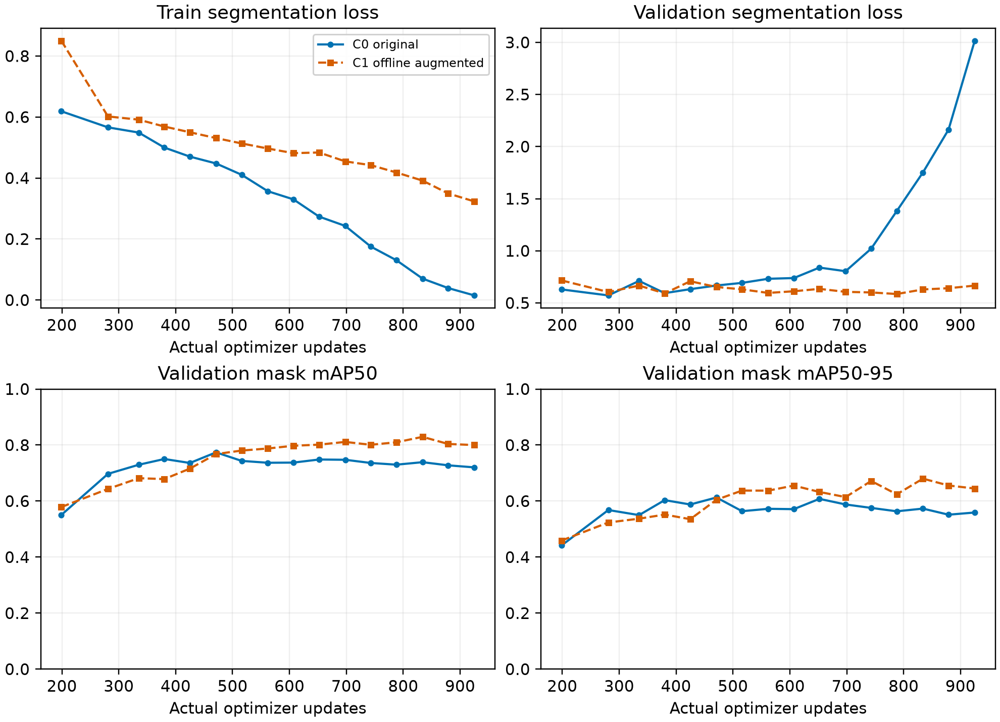
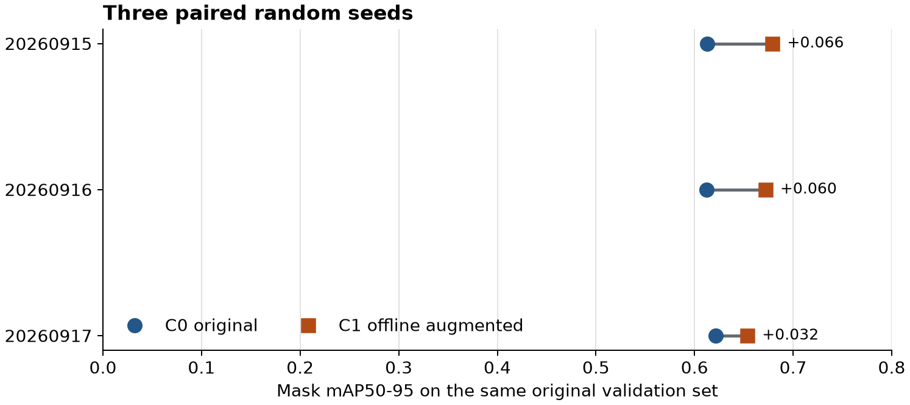
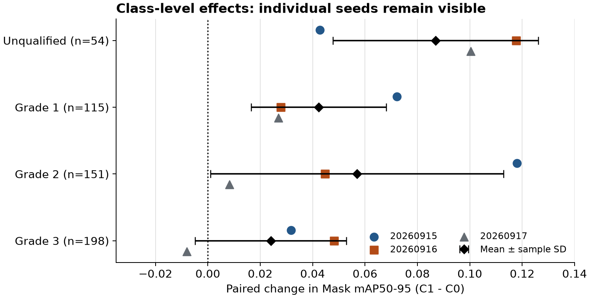

# 枸杞四等级分割：离线增强与三种子复现实验简报

_YOLO26n-seg｜进展汇报｜2026-09-16。C0＝原始训练集；C1＝原始集加离线增强。图表与 CSV 随本文件打包。_

---

## 📋 一句话结论

在同一原始验证集上、严格匹配训练更新预算后，C1 的 Mask mAP50–95 在三个随机种子中均高于 C0；**平均配对提升 0.05257 ± 0.01821**（均值 ± 种子间样本标准差，约 5.26 个 mAP 百分点）。这是数据增强策略的验证集结果，尚不是工业水流测试或网络结构改进的最终结论。

## ⚙️ 从数据增强到公平对照

| 阶段 | 做法 | 得到什么 |
| --- | --- | --- |
| 数据交付 | 966 张原始 train；每张生成水平翻转＋轻微像素变化、仅轻微像素变化各一张，总计 2898 张、12831 个训练实例 | 翻转时同步变换分割多边形；未缩放果实，避免改变基于图像大小的分级依据；原始 val 116 张、518 个实例不增强 |
| 初筛实验 | 同设 100 轮上限、允许早停；C0/C1 分别在第 49/46 轮结束 | 重新验证 `best.pt` 后 Mask mAP50–95 约 0.647→0.689（+0.042）；但 C1 实际训练 minibatch 约为 C0 的 2.82 倍，不能直接归因于增强 |
| 等步数修正 | C0：48×121；C1：16×363，均为 5808 个 minibatch、**925 次真实优化更新**；相同 1089 minibatch warmup 与 16 个可选最佳权重节点 | 同一预训练权重、原始 val、batch 8、输入 640；关闭在线几何/颜色增强；正式配对均关闭 AMP 以避免跳过更新 |
| 三种子复现 | 20260915、20260916、20260917 各独立训练一对，共六条完整训练；重新加载六个 `best.pt` 评估 | 每对的 16 个节点在实际更新数及学习率上逐点匹配；两组 val 图片与标签逐文件一致；test 未参与调参 |

下图只展示 **20260915 一个种子**在 16 个相同更新点的曲线：C0 后期 train loss 下降而 val seg loss 上升，是不能只看 `last.pt` 的例子。它不是三种子的均值曲线，也没有置信区间。

_图 1：20260915 单种子共同更新网格；蓝色圆点为 C0，橙色方点虚线为 C1。原始数值：[matched_step_curves_seed20260915.csv](data/matched_step_curves_seed20260915.csv)。_

## 📊 三种子结果

| 随机种子 | C0 Mask mAP50–95 | C1 Mask mAP50–95 | C1−C0 |
| --- | ---: | ---: | ---: |
| 20260915 | 0.61288 | 0.67905 | +0.06617 |
| 20260916 | 0.61224 | 0.67188 | +0.05964 |
| 20260917 | 0.62166 | 0.65354 | +0.03188 |
| **均值 ± 样本标准差** | **0.61559 ± 0.00526** | **0.66816 ± 0.01316** | **+0.05257 ± 0.01821** |

_图 2：原始 val 上的三组配对结果，横轴从 0 起；连线只表示同种子配对，不是训练轨迹。原始数值：[paired_differences.csv](data/paired_differences.csv)。_

分项均值：不合格 +0.08694、一级 +0.04234、二级 +0.05696、三级 +0.02401。不合格类在 val 中只有 54 颗；**三级有一次负差值（20260917：−0.00799）**，因此不能说每个类别在每个种子中都提升。

_图 3：彩色点为各随机种子的原始差值；黑菱形和横线是三种子的均值 ± 样本标准差，不是置信区间；虚线是零提升。原始数值：[per_class_paired_differences.csv](data/per_class_paired_differences.csv)。_

## 🔍 结论边界与下一步

- 目前只验证了**离线增强训练策略**：三个种子、同一套 val，不能宣称统计显著、真实工业水流场景泛化，或“已改进 YOLO26 网络并优于基线”
- 两组名义图像读取量同为 `46,368`，但原图与增强版本的重复方式不同；实验检验的是这套增强策略整体，而非某一种像素操作的单独因果贡献
- 建议先锁定训练方案，做逐实例错误审计；然后在审核通过的封存 test 上进行一次正式评价，原始背景与合成水槽背景**分别报告**。换背景图共享原始果实来源，不应算成新的独立实拍样本

本简报数字来自本地训练输出与随附 CSV。程序性统计和图示检查参考 Scientific Agent Skills[^1]；它不是本实验性能的外部验证。项目完整实验记录为 `docs/OFFLINE_AUGMENTATION_EXPERIMENT_20260915.md`、`docs/OFFLINE_AUGMENTATION_STEP_MATCHED_EXPERIMENT_20260916.md` 与 `docs/OFFLINE_AUGMENTATION_MULTISEED_EXPERIMENT_20260916.md`。

[^1]: Kassis, T., Agarwal, V., He, Y., Patel, D., & Brueckner, A. M. (2026). “Scientific Agent Skills: A Library of Procedural Knowledge for Research Agents.” *arXiv*. https://doi.org/10.48550/arXiv.2609.00065
