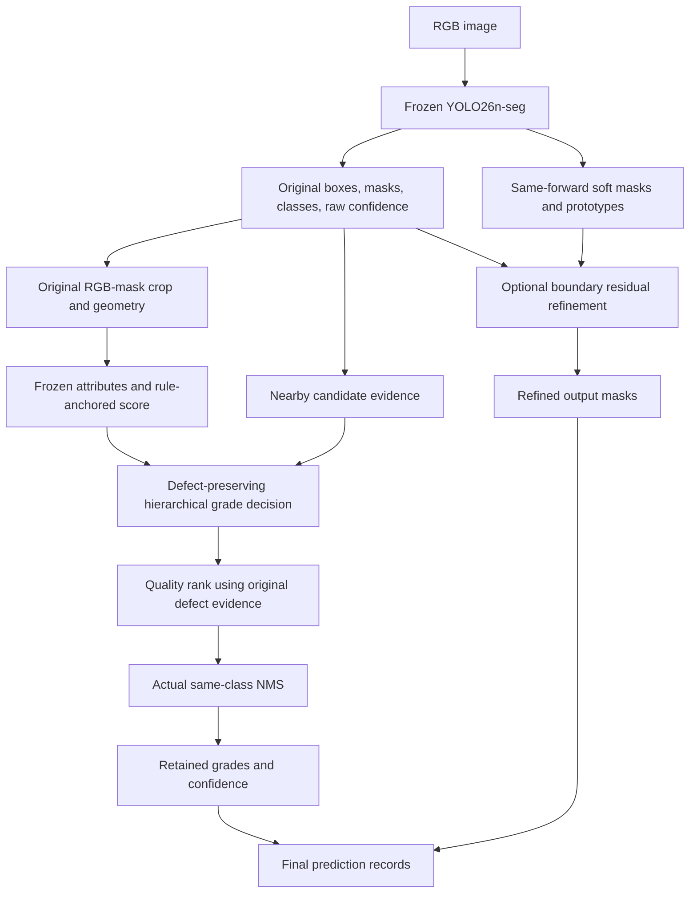

# Hierarchical Decision Making, Quality-Aware Ranking, and Compatible Mask Refinement for Wolfberry Instance Segmentation and Appearance Grading

## Abstract

Wolfberry appearance grading combines defect exclusion, pedicel status, and a continuous size-related score, producing a non-monotonic hierarchy of grade decisions. We develop a modular pipeline around a frozen YOLO26n-seg detector, separating hierarchical grading, prediction quality ranking, and output-mask refinement. A bounded residual corrects an interpretable rule score, nearby candidate evidence assists pedicel and grade-boundary decisions, and a compact ranking head reuses existing defect evidence. An optional output branch refines masks using soft masks and prototype features from the same detector forward pass while preserving the original grading inputs. Evaluation uses 966 training images, a repeatedly accessed development set of 116 images, and a 129-image test partition containing 576 instances evaluated after the candidates were locked. On test, the primary pipeline increases Mask AP50 from 78.04% to 80.72%, a difference of 2.68 percentage points with a paired-image 95% percentile interval of 1.43–4.08 points. Its increment over the RR22 hierarchical reference is 0.97 points, with an interval of 0.27–1.70 points. Correct grading increases from 456/560 to 481/560 localized instances. Output refinement raises Mask AP50–95 from 68.03% to 69.12%, but rematched grading correctness becomes 480/560, demonstrating that unchanged candidate labels do not guarantee unchanged evaluation assignments. The results support task-specific decomposition on the existing partition. Historical baseline use of test, mixed annotation provenance, and only 25 unqualified test instances constrain external-validity and commercial-sorting claims.

Keywords: wolfberry; instance segmentation; appearance grading; hierarchical decision; quality ranking; mask refinement

## 1. Introduction

Image-based wolfberry inspection involves identifying individual fruits and deciding which visible attributes should determine their grade. Recognition and localization have been studied for wolfberry harvesting [1], and dried-goji inspection has also been investigated for spoilage adulteration assessment [2]. Related agricultural work has addressed integrated mangosteen sizing and appearance assessment [3] and segmentation-based pepper impurity estimation [4]. These tasks connect image interpretation to a downstream decision, but their targets differ. In the present dataset, an appearance grade is defined by an explicit combination of defect status, pedicel status, and a continuous morphology-related score. The scope is reproduction and evaluation of these candidate grading rules, rather than measurement of nutritional quality or certification against a commercial standard.

Instance segmentation provides individual masks and class predictions within a common framework, as represented by Mask R-CNN [5], YOLACT [6], and the YOLO26 software family [7]. A direct four-class detector can therefore be trained for the present task. However, the four labels do not form a simple size ordering. A defective fruit is unqualified regardless of size, and an otherwise qualified fruit with a missing pedicel is assigned to Grade 3 even when its size-related score is high. Grade 3 consequently contains distinct attribute combinations. Treating all four grades as an unconditional ordinal sequence would discard the priority structure of the labeling rule.

The problem examined here is how to improve the complete segmentation-and-grading pipeline while maintaining an auditable relationship between its outputs and the underlying attributes. The baseline already localizes 500 of 518 development instances at mask intersection-over-union (IoU) of at least 0.50 within the fixed high-confidence scope. Its remaining errors therefore require attention to grade decisions, candidate competition, and contour quality as well as localization. Our approach preserves the detector and makes these downstream operations explicit, enabling their effects to be evaluated separately.

Three practical challenges motivate the design. First, defect exclusion, pedicel status, and size boundaries have different semantics and error consequences. Second, changing a predicted class changes the meaning of the confidence used to rank competing masks. Quality-aware scoring has already been investigated in Mask Scoring R-CNN [8] and quality-aware object detection [9]; the question here is which existing signals remain useful after appearance-grade reassignment. Third, improving a mask can change the crop and geometric inputs seen by an established grader. Boundary refinement and boundary-sensitive evaluation are established research directions [10,11], but their benefits must be checked against the downstream grading task. A sigmoid score or an increase in average precision also does not establish probability calibration [12].

We develop a hierarchical pipeline with three connected components. A defect-preserving gate and a pedicel decision precede continuous-score grading, with bounded residual correction and local candidate evidence near grade boundaries. A 385-parameter ranking head then reuses existing defect evidence and compact prediction metadata. An optional output branch refines masks using soft-mask and prototype information from the same detector forward pass. The original masks continue to supply grading and ranking features, so the contour presented to the segmentation evaluator can improve without silently changing the established grade inputs.

The contribution is an application-specific integration and its controlled evaluation. The first component makes the heterogeneous grading rules explicit and separates their cumulative grading gains from subsequent ranking gains. The second tests whether reused defect evidence can improve post-reclassification ranking without additional visual adaptation. The third evaluates a compatible dual-mask design against both direct regrading with refined masks and a historical binary-mask refiner. Experiments include fixed-seed comparisons, information-source controls, source-group audits, image-paired uncertainty estimates, actual pipeline timing, and adverse photometric conditions. Development experiments support method construction and ablation; the five locked configurations are additionally evaluated together on the existing test partition, with the two evidence scopes reported separately.

## 2. Related work

### 2.1. Fruit inspection, segmentation, and downstream measurement

Wang et al. studied feature-based wolfberry recognition and localization in unstructured lighting [1], whereas Huang et al. investigated spoilage adulteration in dried goji berries [2]. These studies provide species-relevant context, but harvesting localization and dried-fruit freshness are different targets from the present pedicel-aware grading rules. Kusakunniran et al. addressed the integration of instance-segmentation-based sizing and multi-view mangosteen appearance assessment [3]. Lu et al. combined pepper instance segmentation, geometric feature extraction, and impurity-rate prediction [4]. These works motivate examining the full path from segmentation to the downstream decision, without assuming that performance values transfer across fruit species, annotation rules, or imaging conditions.

Mask R-CNN and YOLACT represent established instance-segmentation approaches [5,6]. YOLO26 provides the detector implementation used in this study [7]. We retain an existing task-trained YOLO26n-seg checkpoint and study the compatibility of its outputs with a separate grader. The proposed pipeline is not a new YOLO backbone, and the experiments do not establish superiority over all contemporary instance-segmentation architectures.

### 2.2. Quality-aware ranking and calibration

Mask Scoring R-CNN studied the mismatch between classification confidence and mask quality [8]. Generalized Focal Loss investigated joint representations of localization quality and classification [9]. Their relevance is the distinction between predicting a class and ranking the quality of that prediction. Here, quality supervision is defined after the appearance-grade decision, and the candidate inputs include an already available defect estimate. The resulting experiment asks whether additional useful information requires new visual adaptation or can be recovered from existing attributes.

Probability calibration concerns agreement between predicted probabilities and correctness frequencies [12]. Our ranking target averages compatibility across several mask-IoU thresholds, and the output is multiplied by the original detector confidence. Accordingly, we use the term quality ranking. Neither binary cross-entropy training nor a sigmoid output is treated as sufficient evidence of calibrated correctness probabilities or safe automatic rejection.

### 2.3. Boundary refinement and downstream compatibility

PointRend addressed high-quality image segmentation through a point-based rendering perspective [10], and Boundary IoU introduced an evaluation measure focused on contour quality [11]. These directions motivate using fine-grained information and evaluating geometric fidelity beyond AP50. Our implementation is a dense pointwise residual head using detector prototypes; it does not reproduce the full PointRend algorithm. Its central design choice is to preserve the grading representation while refining the segmentation output. This choice is evaluated explicitly because improved contour overlap did not consistently improve grading when the refined masks were fed back into the existing scorer.

## 3. Materials and methods

### 3.1. Dataset, annotations, and candidate grades

The development experiments use 966 original training images with 4,277 annotated fruits and 116 validation images with 518 fruits. We call the latter the development set because it was repeatedly consulted during method development. The original training images are divided by image into 773 fitting images and 193 internal holdout images for the newly fitted modules. All fruits and derived views from an image remain in the same role. These internal roles do not provide a wholly unseen evaluation of the complete system: the frozen detector and earlier grading components had already been trained on the original training population.

Table 1. Image and instance counts from the train/val multitask manifest and verified test label manifest.

| Partition | Images | Unqualified | Grade 1 | Grade 2 | Grade 3 | Total instances |
|---|---:|---:|---:|---:|---:|---:|
| Original train | 966 | 372 | 945 | 1,138 | 1,822 | 4,277 |
| Development | 116 | 54 | 109 | 150 | 205 | 518 |
| Final test | 129 | 25 | 126 | 167 | 258 | 576 |
| New-module fitting role | 773 | — | — | — | — | Subset of original train |
| New-module holdout role | 193 | — | — | — | — | Subset of original train |

The final two rows describe overlapping roles within the original train partition and must not be added to its image or instance counts. Class totals for these roles are not needed for the reported overall comparisons.

Manual instance contours support geometric feature extraction. Defect and pedicel review contributes attribute labels, and part of the final grade assignment is generated using frozen interpretable rules. The continuous target is consequently a rule-derived score, not an independent expert rating of overall fruit quality. Missing attribute labels are excluded from the corresponding supervised objective rather than assigned a negative value.

The frozen score configuration gives weights of 0.7 to the area percentile, 0.1 to the minor-axis percentile, and 0.2 to the shape score. Color-uniformity features are retained for description but have zero direct grade weight in this configuration. The two size-score cutoffs are 37.40298225745565 and 65.62684031710077. Defective fruits are unqualified; qualified fruits with missing pedicels are Grade 3; the remaining fruits are assigned Grades 1, 2, or 3 by the upper and lower cutoffs. These rules explain why Grade 3 is heterogeneous.

Dimensions are expressed in pixels and areas in square pixels; no reliable pixel-to-millimeter calibration is available. The study therefore does not establish compliance with physical-size commercial standards. The verified test partition contains 129 images and 576 instances: 302 labels reflect agreement between two reviewers, 51 were manually adjudicated by the lead reviewer, and 223 retain the frozen base-rule label. Six duplicate polygons were removed during the historical export from 582 review entries; no test labels were changed in the present evaluation. Validation uses a single-reviewer overlay correcting seven class labels without changing polygon coordinates, whereas test uses the original v3 labels. An early baseline had already been evaluated on test. Subsequent new modules were not fitted or selected using test, and the locked configurations receive the present uniform evaluation; this partition is not a never-accessed external test set.

### 3.2. Frozen detector and hierarchical attribute representation

The detector is the existing YOLO26n-seg offline-augmentation checkpoint trained under the recorded 200-epoch protocol, with seed 20260915 and the end-to-end head enabled. Its training used 2,898 delivered training images derived from 966 original images, with online scale-changing and compositional augmentations disabled. These derived images do not represent additional independent fruit collections. The current paper evaluates the frozen checkpoint on the current annotation version; historical training-log metrics from earlier annotation versions are not substituted for the current replay results.

The independent grader consumes an RGB-plus-mask crop letterboxed to 160 × 160 pixels together with six mask/crop geometry descriptors. Its visual channels progress through 32, 64, 128, 192, and 256, followed by global pooling. A geometry network maps the six descriptors to 32 dimensions. Concatenation and fusion yield a 256-dimensional representation with defect, missing-pedicel, and score outputs. This earlier representation is frozen in the compact ranking candidate.

The deployed research policy preserves the detector's original unqualified class as the defect veto. The original grader's defect logit is reused as ranking evidence; it is not silently substituted as a new defect gate in the main candidate. Qualified high-confidence candidates receive pedicel and continuous-score decisions. Low-confidence candidates remain in the AP pool but are not regraded, and invalid attribute outputs fall back to the original class.

Figure 1. Pipeline and the separation between grading and output segmentation.

The refined output masks do not feed back into the grading or ranking features. Original prediction indices align every retained field.

### 3.3. Rule-anchored residual scoring and local decision evidence

We distinguish three score sources: the earlier learned score, a score computed directly from predicted-mask features using the frozen rule, and a bounded learned correction to the direct-rule score. The latter is the score component of the reference denoted RR22. RR22 is an experimental shorthand, not a detector architecture. In this manuscript, the full RR22 reference also includes the boundary/pedicel evidence policy and actual same-class NMS.

For a frozen 256-dimensional fused feature $f$, a fitting-role mean $\mu$, and standard deviation $s$, the implemented rule-anchored residual is

$$
\widehat q=100\,\operatorname{clip}\left(q_{\mathrm{rule}}/100+0.05\tanh h_\theta((f-\mu)/s),0,1\right).
$$

Here, $q_{\mathrm{rule}}$ is the direct-rule score and $h_\theta$ is a 256→32→1 multilayer perceptron with a SiLU hidden activation and a zero-initialized final layer. The correction is bounded by five score points before clipping. The original training population contains 3,053 fitting and 761 holdout score instances. Training uses AdamW, learning rate 0.001, weight decay 0.001, batch size 128, a maximum of 60 epochs, and patience 12 based on holdout mean absolute error (MAE). The objective combines Smooth L1 loss on scores normalized to [0,1], an ordinal auxiliary loss conditional on the size task, and a squared-residual penalty. The original rule-residual experiment did not pass its prespecified practical MAE-improvement gate; its later use as a reference is an exploratory pipeline decision and does not reverse that result.

For local evidence, each candidate collects the maximum original top-class confidence for each class among boxes with IoU at least 0.85. Missing classes receive a small fixed floor of $10^{-4}$. This four-vector aggregates nearby candidates. It is different from the true four-class output of one candidate, which was separately captured before the detector's top-k step and aligned to candidate indices. Neither vector is assumed to sum to one or represent a calibrated posterior. The main policy uses the neighborhood vector; extracting a same-candidate distribution alone is not claimed to be the source of the final improvement.

The policy modifies size margins only near their respective thresholds. For threshold $T$, corresponding adjacent-class logit difference $d$, and score $\widehat q$, the implemented adjustment is

$$
m_T=\widehat q-T+\lambda\exp\left[-\tfrac12((\widehat q-T)/\sigma)^2\right]\tanh(d/3),
$$

with $\lambda=1.5$ and $\sigma=2.5$. The upper and lower adjusted margins determine the size grade. Missing-pedicel evidence uses the original missing-pedicel logit plus 0.5 times the difference between neighborhood Grade-3 evidence and the larger of Grade-1/Grade-2 evidence. A nonnegative result assigns Grade 3. The unqualified veto precedes these decisions. The main candidate does not enable recovery of originally unqualified predictions into qualified grades.

### 3.4. Quality ranking and actual duplicate suppression

Reclassification can create competing candidates of the same final grade. The present detector runs an end-to-end output path, so it is incorrect to assume that a conventional class-offset NMS has already eliminated every original same-class collision. We therefore compare the original detector both with and without the same additional NMS used by the grading pipeline.

Actual NMS uses box IoU 0.70 within each final class. Candidates with original confidence at least 0.25 take priority over lower-confidence candidates; within each scope, ordering uses the chosen ranking score and stable index tie-breaking. This scope priority is an explicit evaluation choice. Suppressed rows are removed from boxes, masks, classes, scores, and all aligned metadata before matching is recomputed. Merely changing a duplicate's score is not counted as removal. The method does not establish a unique physical-fruit identity across every remaining cross-class candidate.

The ranker uses 18 core features and four additional channels. The core contains original confidence, the fruit score and threshold distance, pedicel evidence, normalized mask and box geometry, original/final class indicators, and neighborhood class logits. The original-defect variant adds the original defect logit divided by 10, normalized binary entropy, an availability indicator, and one zero channel. Features are standardized using fitting predictions only. The architecture is 22→16→1 with SiLU, containing 385 allocated trainable parameters. Zero-filled controls have the same allocated architecture but do not have equal effective information capacity.

For candidate $i$, let $v_i$ be its maximum mask IoU with any training GT of the same final class, or zero if no compatible GT exists. The independent multi-IoU target is

$$
y_i=\frac{1}{10}\sum_{t\in\{0.50,0.55,\ldots,0.95\}}\mathbf{1}(v_i\ge t).
$$

This pointwise target does not allocate one GT exclusively to one prediction. Actual duplicate competition is handled downstream. The ranker is fitted with binary cross-entropy, AdamW at learning rate 0.003 and weight decay 0.0001, batch size 256, maximum 300 epochs, and patience 30 based on holdout loss; epoch zero is eligible. Final nonzero classes receive original confidence multiplied by the sigmoid rank output. Final class 0 retains its original confidence. The operating scope remains original confidence ≥0.25, regardless of the new score.

Controls include zero extra channels, availability-only information, newly adapted defect evidence, and original defect evidence. The new-attribute family was selected internally before its development results were examined. The original-defect variant was added as an adaptive mechanism control after earlier feedback and subsequently frozen as the primary candidate for the final test evaluation reported here. Its fixed reporting seed is 20261025; the better development seed is not substituted.

### 3.5. Compatible output-mask refinement

The refinement branch captures the pre-threshold mask information and 32 prototype channels from the same detector forward pass. It uses RGB, one coarse-mask channel, and the prototype channels as 36 inputs to a pointwise 36→32→16→1 convolutional head with SiLU activations. The last layer starts at zero, and the residual is bounded by $6\tanh(\cdot)$. A two-by-two design compares hard versus soft coarse input and zero versus actual prototypes, with RGB retained in all arms.

Training operates on 160 × 160 crops; prototype maps are interpolated to that grid. The residual is then bilinearly mapped to the original image crop and added to the original binary-mask logits of −2/+2 only within a fixed four-pixel native boundary band. The final threshold is zero. A zero residual therefore reproduces the original mask exactly, and resizing a coarse crop does not replace the original segmentation. The objective combines boundary-weighted binary cross-entropy and Dice loss. AdamW uses learning rate 0.001, weight decay 0.0001, batch size 32, maximum 30 epochs, and patience 8. Checkpoints are selected using internal native-grid IoU and relative-area error. Additional equal-30-epoch fits check whether early-stopping dose explains the factorial comparison.

The full GT area, including any area outside the crop, enters native-grid union and area-error calculations. The output-only variant retains original grading and ranking masks and applies the refined mask only to the final segmentation output. A separate full-regrading variant recomputes the legacy grader from refined masks and is retained as a compatibility control.

## 4. Experimental design

### 4.1. Evaluation endpoints and operating scope

Full-pipeline AP is calculated separately using every GT in the 116-image development set or the 129-image test partition and the original detector pool down to confidence 0.001, maximum 300 predictions per image, input size 640, FP32, and native-resolution masks. Class-aware matching is evaluated at IoU thresholds 0.50:0.05:0.95. AP is computed using the recorded Ultralytics matching/AP implementation; the threshold range follows the official COCO evaluation convention [13,14]. We do not claim byte-for-byte equivalence to every alternative COCO evaluation implementation.

Grading uses retained predictions whose original confidence is at least 0.25. Class-agnostic optimal mask matching at IoU ≥0.50 defines localized fruits; grade correctness is then measured on those matches. We report correct/localized and correct/all GT separately. Operating macro-F1 additionally accounts for class-aware false positives and false negatives in that original-confidence scope. The 449 correct grades and the number of class-aware AP true positives are different quantities and are not interchanged.

Risk endpoints include matched unqualified GT assigned a qualified grade, matched qualified GT rejected as class 0, and previously correctly rejected unqualified instances newly assigned a qualified grade. An additional diagnostic records any high-confidence qualified output overlapping an unqualified GT at mask IoU ≥0.50, even when another candidate is matched to that GT. It is an output-exposure diagnostic, not the one-to-one error count or a verified physical-fruit decision.

### 4.2. Repeated fits, source groups, and uncertainty

The latest stage contains 150 completed optimization fits across attributes, score heads, rankers, and refiners, with no new YOLO training. Earlier stages retain their own inventories. Fit counts are not treated as independent datasets. Newly created ranking and refinement heads vary initialization and minibatch order across seeds; pretrained attribute variants start from the same original checkpoint and primarily vary ordering.

Source ranges 001–150, 151–500, 501–900, and 901–1300 provide proxy grouping. They have not been verified as independent harvest batches or distinct physical-fruit populations. Source-held-out ranker audits exclude the outer group from new-ranker fitting, normalization, and checkpoint selection, while the older frozen components have already seen original train data. Pooled source-audit AP is recomputed after concatenating predictions, rather than averaging per-source AP.

Uncertainty for the fixed ranking comparison uses 2,000 paired image-bootstrap draws stratified by the four source ranges. All fruits in an image remain together, and sampled image indices are sorted to preserve confidence-tie behavior. Intervals are pointwise percentile 95% intervals without adjustment for repeated development feedback, adaptive comparisons, or multiplicity. Three optimization seeds do not supply three independent datasets. These intervals are exploratory descriptions rather than confirmatory evidence of generalization.

### 4.3. Computing environment and timing

Experiments use Windows, Python 3.12.14, PyTorch 2.13.0+cu130, Ultralytics 8.4.117, and an NVIDIA GeForce RTX 5070 Laptop GPU. Matrix-multiplication TF32 is disabled; CuDNN TF32 remains enabled. The installed native-mask routine already contained a memory-chunking patch before the latest stage; the exact source and hash are archived. It is not described as an unmodified package installation.

The latest timing study uses 24 development images, six per source range, with three repetitions and randomized graph order per image. GPU synchronization brackets each measurement. Image decoding and model loading are excluded. Timings include the actual detector, grading, ranking, and relevant postprocessing path at confidence pool 0.001. Historical measurements with a different pool or implementation are kept in their own comparison and are not mixed into the latest timing table.

### 4.4. Final evaluation of the frozen configurations

Before test inference, image and label provenance, instance-row lineage, model/configuration hashes, and the runtime environment were verified. Full-val replay of the five arms reproduced all 110 compared metrics exactly. The locked arms are the original detector, original detector with same-class NMS, RR22, the original-defect ranker primary pipeline, and that pipeline with output refinement, all using reporting seed 20261025. The arms reuse a frozen detector forward; inference receives no GT, and saved predictions are evaluated under the same protocol. Models, thresholds, NMS, and arm roles were not changed in response to test results.

The pre-test primary endpoint is the Mask AP50 difference between the primary pipeline and RR22. Other endpoints and the original-detector contrasts are reported as secondary results. Test intervals use 2,000 paired image-bootstrap draws stratified by the four existing source ranges, with seed 20261027. Arms and the primary endpoint were frozen before test; detailed resampling settings were recorded after viewing test point estimates and before computing intervals. This is not a prospectively registered complete statistical analysis. Intervals are pointwise percentile 95% intervals without multiplicity adjustment or significance stars. Each draw retains all instances in an image and shares image multiplicities across methods; all 2,000 draws contain all four GT classes.

Independent test targets for continuous score, defect, and pedicel attributes have not been verified, so corresponding test MAE or attribute accuracies are not reported. Shared-forward evaluation wall time includes GT loading, IoU calculations, and file writes and is not a per-arm latency measurement. The separate timing comparison on development images remains in Section 5.5.

## 5. Results

### 5.1. Development-set complete-pipeline comparison

Table 2 reports current fixed-seed results together with earlier same-protocol grading controls. The hierarchical reference improves correct grading over the direct detector, and the latest ranking changes AP without changing the observed grading count. The same-NMS raw detector control attributes part of the gain to shared duplicate removal.

Table 2. Development-set segmentation and grading. AP values are percentages. Every listed configuration localizes 500 of 518 GT in the fixed original-confidence scope. Earlier controls are replayed under the common full-GT/NMS protocol; their historical timings are omitted.

| Method | Mask AP50 (%) | Mask AP50–95 (%) | Correct/localized | Conditional accuracy (%) | Correct/all GT (%) |
|---|---:|---:|---:|---:|---:|
| Original YOLO26n-seg | 83.48 | 70.21 | 416/500 | 83.2 | 80.31 |
| Original YOLO26n-seg + actual NMS | 84.15 | 70.68 | 416/500 | 83.2 | 80.31 |
| Original R1 + own rank + same NMS | 85.33 | 71.62 | 439/500 | 87.8 | 84.75 |
| Learned residual + own rank + same NMS | 85.76 | 71.89 | 442/500 | 88.4 | 85.33 |
| Direct rule + own rank + same NMS | 85.38 | 71.75 | 443/500 | 88.6 | 85.52 |
| Direct rule + boundary/pedicel evidence + same NMS | 86.52 | 72.56 | 450/500 | 90.0 | 86.87 |
| RR22 hierarchical reference | 86.70 | 72.72 | 449/500 | 89.8 | 86.68 |
| Historical 18-feature rank on RR22 | 86.69 | 72.73 | 449/500 | 89.8 | 86.68 |
| New-defect quality rank, internally selected | 87.05 | 73.24 | 449/500 | 89.8 | 86.68 |
| Original-defect quality rank, fixed seed 25 | 87.10 | 73.29 | 449/500 | 89.8 | 86.68 |
| Original-defect rank + output refinement | 87.10 | 74.23 | 449/500 | 89.8 | 86.68 |

The cumulative AP50 difference between the last configuration and the original detector is 3.62 percentage points, or 2.95 points relative to the raw detector with the same added NMS. The latest original-defect rank contributes 0.40 points over RR22, rather than the entire cumulative gain. Direct-rule boundary/pedicel grading obtains one more correct grade than RR22 on this set, so the selected pipeline does not dominate every comparator on every endpoint.

Table 3. Earlier fixed-score comparison before the later shared-NMS and boundary-evidence changes. The score MAE population is 448 rule-target instances. Times belong exclusively to the same historical 24-image × five-repeat comparison.

| Earlier configuration | Correct/500 | Rule-score MAE (points) | Mean latency (ms/image) |
|---|---:|---:|---:|
| Original R1 + own rank | 439 | 2.1397 | 53.75 |
| Selected learned residual + own rank | 442 | 2.0274 | 54.51 |
| Direct rule + own rank | 443 | 1.9261 | 65.56 |
| Rule-anchored residual + own rank | 443 | 1.9092 | 66.19 |

The earlier learned residual provides a speed–score-accuracy tradeoff within that measurement. The direct-rule and rule-anchored variants have lower MAE point estimates, while the learned residual has lower latency. These numbers do not establish that the final RR22 pipeline runs at the earlier 54.51 ms/image, nor that the rule-anchored residual passed its original practical gate.

### 5.2. Ranking information and uncertainty

Table 4 isolates the effect of additional ranking information. Every row retains the same observed 449/500 correct grades. Original defect evidence outperforms the availability-only control for all three fitted seeds, and newly trained defect evidence is not required to obtain the AP gain.

Table 4. Ranking controls on RR22, original output masks. AP values are percentages. Historical 18-feature ranking uses fixed seed 20261024; all newly fitted rows use 20261025 unless a seed range is explicitly stated.

| Ranking variant | Mask AP50 (%) | Mask AP50–95 (%) | Selection status |
|---|---:|---:|---|
| Original raw confidence | 86.7046 | 72.7225 | Fixed RR22 reference |
| Historical 18-feature rank | 86.6942 | 72.7307 | Earlier internal selection |
| Core 18 + four zeros, multi-IoU target | 86.6691 | 72.7510 | Paired information control |
| Core 18 + availability only | 86.5808 | 72.7411 | Adaptive mechanism control |
| Core 18 + new defect evidence | 87.0522 | 73.2362 | Internally selected new family |
| Core 18 + original defect evidence | 87.1013 | 73.2874 | Adaptive control, subsequently frozen |
| Original defect, seeds 25/26/27 | 87.1013 / 87.1468 / 87.3170 | 73.2874 / 73.2936 / 73.4414 | All repeats retained |

The fixed original-defect rank versus RR22 has an AP50 difference of +0.397 percentage points, with an exploratory 95% interval of [−0.141, +0.959]. The AP50–95 difference is +0.565 points, with interval [+0.013, +1.045]. Against the paired zero-information quality target, its AP50 difference is +0.432 points, with interval [+0.028, +0.782]. These pointwise intervals do not account for adaptive family addition or repeated development use. In particular, the main AP50 interval relative to RR22 includes zero.

When one development source range is excluded at a time, the AP50 point gain remains approximately +0.33 to +0.62 points. In separate new-ranker source-held-out audits on original train, pooled AP50 ranges from 97.35% to 97.38% for original-defect ranking and from 97.23% to 97.27% for the zero-extra control across seeds. These high training-population values audit the new ranker only and are not independent whole-system generalization results.

Figure 2. Ranking information controls and new-ranker source audits. Filled points identify fixed seed 25, and other points retain the remaining seeds. Original-defect ranking is an adaptive control. Frozen upstream components have seen original train data; the source panel must not be interpreted as a whole-system out-of-distribution test.

### 5.3. Output refinement and grading compatibility

The selected soft-mask/prototype family improves native-grid overlap and area error relative to the original mask. However, direct use of refined masks by the legacy grader does not reliably preserve complete-pipeline performance. Table 5 separates output-only refinement from full regrading and retains the historical binary-mask model as a strong comparator.

Table 5. Refinement and compatibility on RR22 with raw confidence, without the new defect rank. New-model seed is 25; historical binary-model seed is 23. Geometry is measured on the fixed original 500 matches; mean relative errors are dimensionless. Geometry columns describe the masks, independently of which grading input path is used.

| Mask/output policy | Mask AP50 (%) | Mask AP50–95 (%) | Correct/localized | Mean IoU | Relative area error | Relative minor-axis error |
|---|---:|---:|---:|---:|---:|---:|
| Original mask | 86.70 | 72.72 | 449/500 | 0.91390 | 0.05532 | 0.04285 |
| Historical binary refinement, output only | 86.70 | 73.87 | 448/500 | 0.91863 | 0.04381 | 0.03189 |
| Soft + prototype, output only | 86.70 | 73.70 | 449/500 | 0.91917 | 0.04354 | 0.03281 |
| Soft + prototype, full legacy regrading | 86.40 | 73.45 | 448/500 | 0.91917 | 0.04354 | 0.03281 |

Output-only means that the candidate labels and rank inputs are fixed, not that downstream rematching must produce identical conditional counts. The historical model changes a match sufficiently to yield 448 observed correct grades and 11 qualified rejections. The new prototype output variant retains 449 and 10 in this comparison. Conversely, the historical model has the higher AP50–95 point value and lower minor-axis error. The prototype head therefore does not dominate that control on all segmentation measures.

Combined with original-defect ranking, the prototype output branch reaches 74.23% AP50–95, compared with 73.29% for that ranker using original masks. AP50 and the observed grading count remain unchanged. The factorial experiment and equal-30-epoch extension support the usefulness of the prototype input in the evaluated design, while zeroed prototype channels do not constitute an equal-effective-capacity model.

Figure 3. Native-grid mask geometry and boundary-width sensitivity. The geometry cohort is fixed before refinement. Boundary IoU is examined at fixed pixel radii and image-diagonal-relative widths; these settings and the historical strong control are retained. The polygons are image annotations, not physical metrology.

Figure 4. Selected improvement, decline, and near-median examples from the fixed cohort. Examples were chosen by GT-based IoU change for illustration. The original RGB pixels are retained; the images do not imply representative success rates or GT access at inference.

### 5.4. Operating errors and output exposure

The original detector has operating macro-F1 of 77.48%, increasing to 78.27% with actual same-class NMS and 84.37% for RR22 and the selected ranking/output variants. Localization remains 500/518. The final 51 matched grading errors are separate from 18 unlocalized GT, and AP cannot be inferred from either count alone.

Among 54 unqualified GT, 52 are localized and 21 matched fruits are assigned a qualified grade by the main configurations. Ten matched qualified fruits are rejected as unqualified. The final rank/output variant does not add newly misaccepted GT relative to the fixed main reference on this development set. Nevertheless, 24 unqualified GT have at least one retained high-confidence qualified output overlapping them. Preserving the original class-0 gate therefore does not establish a safe physical sorting policy.

The main configuration also does not achieve the best observed exploratory grading count. A separately explored, analytically prior-corrected defect-creation policy obtains 451/500 with 19 matched unqualified escapes and 10 qualified rejections at seed 25; the other seeds obtain 450/500. This variant was not the internally selected primary defect policy. Its raw, uncorrected counterpart has 448/500 and 15 rejections at the same seed. We retain this distinction and do not promote the larger development count as an independently validated main result.

### 5.5. Actual inference cost

Table 6. Latest same-run latency, confidence pool 0.001, 24 images × three repeats. Times exclude image decoding and model loading. The shared reference computes the same baseline feature path as the compact ranker; the lean reference is a separately implemented RR22 path.

| Actual inference graph | Mean latency (ms/image) |
|---|---:|
| Original YOLO API | 23.11 |
| Lean RR22 reference | 120.02 |
| Shared-computation RR22 reference | 118.01 |
| Original-defect quality rank | 119.01 |
| Original-defect rank + output refinement | 141.92 |
| New-defect rank, strict replay path | 138.79 |
| New-defect rank, explicit prefix reuse | 120.79 |

The original-defect rank adds approximately 1.00 ms/image to the matched shared-computation reference. The output refinement adds a visible further cost. The entire grading pipeline remains substantially slower than the detector API alone. The strict replay and prefix-reuse graphs are kept separate because floating-point differences occur when visual batches are rearranged; they are not described as bit-identical execution paths.

Figure 5. Actual same-device timing with image-paired intervals. Measurements include the relevant detector, attributes, ranking, and refinement operations. Repetitions are measurements of the same 24 images, not independent image samples.

### 5.6. Negative results and stress conditions

Earlier same-dose detector adaptation did not show an advantage of the tested directional/partial-channel modules over the matched control. Some detector changes improved native detection while reducing the performance of the frozen grading cascade. This finding supports evaluating representation compatibility rather than selecting an upstream detector using its native AP alone. It does not prove that joint retraining or a different detector adaptation could never help.

Table 7. Selected adverse conditions for fixed original-defect ranking. Each condition contains the same 518 GT and is evaluated using fresh predictions from the transformed image. Conditional denominators vary with localization; correct/all GT supplies a common denominator.

| Synthetic condition | Correct/localized | Correct/all GT (%) | Mask AP50 (%) |
|---|---:|---:|---:|
| Clean | 449/500 | 86.68 | 87.10 |
| Global brightness ×0.70 | 266/498 | 51.35 | 63.10 |
| Global color shift | 216/498 | 41.70 | 47.21 |
| Background color shift | 328/492 | 63.32 | 70.68 |
| Foreground color shift | 172/484 | 33.20 | 47.42 |
| Foreground darkening + background color shift | 147/488 | 28.38 | 37.73 |

Foreground/background transforms use the predicted foreground, not GT masks, and are synthetic diagnostics rather than real deployment data. The full ten-condition matrices are retained in the experimental report. Ranking does not repair the large number of incorrect grades under these conditions. A binary-geometry scoring branch improves some dark-condition counts but reduces clean grading to roughly 404–408 correct instances; it fails the internal replacement criterion. Spatial branch selectors also show tradeoffs between clean grading and selected interventions.

GT-substitution diagnostics indicate that attribute and boundary-fusion errors interact. Even after substituting GT attributes, neighborhood boundary fusion can overturn 11 otherwise correct threshold decisions. These substitutions diagnose the frozen logic and are not attainable-model performance, a physical ceiling, or evidence of runtime access to GT. They identify reliability-controlled boundary fusion as a remaining question rather than an additional validated contribution.

### 5.7. Final test results for the frozen configurations

Table 8. Test results under the frozen protocol: 129 images and 576 GT instances. All five arms localize 560 instances. AP and percentage endpoints are expressed as percentages.

| Locked configuration | Mask AP50 | Mask AP50–95 | Correct/localized | Conditional grading accuracy | Correct/all GT | Operating macro-F1 |
|---|---:|---:|---:|---:|---:|---:|
| Original YOLO26 | 78.04 | 65.84 | 456/560 | 81.43 | 79.17 | 72.56 |
| Original YOLO26 + same-class NMS | 78.89 | 66.46 | 456/560 | 81.43 | 79.17 | 73.54 |
| RR22 hierarchical reference | 79.75 | 67.16 | 481/560 | 85.89 | 83.51 | 77.79 |
| Original-defect rank, primary | 80.72 | 68.03 | 481/560 | 85.89 | 83.51 | 77.79 |
| Primary + output refinement | 80.72 | 69.12 | 480/560 | 85.71 | 83.33 | 77.79 |

The primary pipeline gains 2.68 AP50 percentage points over the original detector, compared with 3.62 points on development data. Against the original detector with the same added NMS, the increment is 1.83 points. Ranking contributes 0.97 points over RR22 without changing grading correctness; hierarchical processing from the original detector to RR22 adds 25 correct grades. The cumulative and component gains are attributed using their respective controls.

Table 9. Paired-image test differences with pointwise percentile 95% intervals, in percentage points. Intervals are descriptive and not adjusted for multiplicity.

| Fixed contrast | Endpoint | Point estimate | 95% lower | 95% upper |
|---|---|---:|---:|---:|
| Same-class NMS − original YOLO | AP50 | 0.85 | 0.61 | 1.10 |
| RR22 − same-NMS YOLO | AP50 | 0.86 | -0.50 | 2.34 |
| Primary − RR22 (primary endpoint) | AP50 | 0.97 | 0.27 | 1.70 |
| Primary − original YOLO | AP50 | 2.68 | 1.43 | 4.08 |
| Primary − same-NMS YOLO | AP50 | 1.83 | 0.64 | 3.16 |
| Output refinement − primary | AP50–95 | 1.09 | 0.63 | 1.67 |

The primary endpoint interval is 0.27–1.70 points; the cumulative interval against the original detector is 1.43–4.08 points. The AP50 interval for RR22 versus the same-NMS detector crosses zero, so not every individual module contrast has independent statistical confirmation. All four proxy source groups have more correctly graded instances than the original detector, but the groups are not verified independent harvest populations.

Output refinement preserves AP50 at 80.72% and increases AP50–95 from 68.03% to 69.12%, a difference of 1.09 points with an interval of 0.63–1.67 points. Candidate labels, ranks, and retained rows are unchanged. However, for instance wb_000911__i001, class-agnostic assignment switches from grade-3 candidate row 1 to unqualified candidate row 2, whose refined IoU is higher. Correct grading decreases from 481 to 480 and matched qualified rejections increase from 37 to 38. This negative result shows that preserving grading inputs does not guarantee invariant correctness after geometry-dependent rematching.

All 25 unqualified GT are localized. Each arm has two matched escapes and three unqualified GT overlapped by at least one retained qualified output. The primary pipeline and original detector both reject 37 matched qualified instances, increasing to 38 with output refinement; newly misaccepted unqualified GT relative to RR22 remain zero. Matched escape is 2/25, or 8%. A zero incremental difference on these images is not zero absolute risk or population equivalence. Unqualified-class AP remains substantially lower than AP for the qualified grades (Appendix Table A4).

## 6. Discussion

### 6.1. Attribution of the cumulative improvement

The results distinguish three mechanisms that a single AP number would combine. Hierarchical decisions alter grade labels. Quality ranking changes the order and competition of predictions. Output refinement changes mask geometry. On this development set, the latest ranker improves AP with no change in observed grading accuracy, whereas the broader pipeline improves both grading and AP relative to the direct detector. The additional same-NMS raw-detector control shows that duplicate removal also contributes. These components must therefore be credited using their own matched comparisons.

The ranking contribution is deliberately narrower than a new generic scoring paradigm. Quality-aware mask scoring and detection already have established precedents [8,9]. The useful finding here is that original defect evidence, already available in the grading representation, can support post-reclassification ranking with a small extra head. The control does not establish that new visual training is universally unnecessary; it shows that such training was unnecessary for the observed clean-set AP increment in this configuration. Nor does the result establish probability calibration in the sense of agreement with correctness frequencies [12].

### 6.2. Why improved masks need compatibility checks

The legacy scorer depends on mask-derived geometry and crop statistics. Changing the mask therefore changes the grader's input distribution, even when mask overlap improves. The observed regrading regressions are consistent with this compatibility explanation. Retaining original masks for grading and refined masks for segmentation output avoids forcing an unadapted scorer to consume a new representation. The dual-mask policy is consequently an explicit system interface, not evidence that segmentation and grading are independent tasks.

Its cost is additional mask processing and two representations that must remain aligned by candidate index. The historical refiner also remains competitive on several contour endpoints. Future evaluation could test a scorer explicitly trained for refined geometry, but the present data do not establish the benefit of that extension. The practical contribution is an evaluated compatibility choice under the existing frozen components.

### 6.3. Validity of the target and scope of generalization

Part of the reference grade is generated from the same family of interpretable measurements used by direct-rule prediction. High agreement therefore partly measures reproduction of a predefined decision procedure. It does not validate nutritional quality, market value, an independent expert consensus, or a national commercial grade. Manual contour quality and attribute review improve the annotation basis but do not remove this distinction. An independent commercial-quality assessment would require an independently defined target and, for physical dimensions, a documented calibration procedure.

Repeated development use and historical test use constrain statistical interpretation. The original-defect pipeline was frozen after an adaptive mechanism comparison; pointwise bootstrap cannot erase that selection history. The locked test results add evidence on the existing partition rather than a newly collected external validation. The frozen detector is a single historical training run, and three new-head seeds do not quantify whole-pipeline training variability. Absence of byte-identical images across train, validation, and test does not exclude shared physical fruits, adjacent frames, or acquisition sessions. Furthermore, 223/576 test labels retain the frozen rule and only 25 test instances are unqualified, limiting independent target validity and precision of risk estimation.

Photometric failures further limit deployment claims. Synthetic tests expose large grading sensitivity even when localization remains comparatively high. No completed water-flow apparatus experiment, controlled online sorting trial, or multi-site independent evaluation is reported. Matching-based rejection counts also leave unresolved how to issue one actionable decision per physical fruit when cross-class candidates remain. A lower AP error or zero newly misaccepted instances on this val set cannot replace an explicit physical-output and rejection policy.

### 6.4. Interpretation after locked evaluation and remaining boundaries

The five configurations have now been evaluated under one frozen annotation and metric protocol, preserving the reporting seed, confidence scope, NMS, grade cutoffs, and rank formula. The primary pipeline has AP50 difference intervals above zero against both the original detector and RR22. These are pointwise descriptions of this partition and cannot remove shared target construction, historical test use, or physical-fruit dependence. Output refinement increases AP averaged over strict IoU thresholds while adding one rematched grading error; this tradeoff belongs in the compatibility analysis. The completed test partition is not used for further candidate selection. Independently collected groups remain future work for external validity.

Further method development is best driven by the observed failures: reliable pedicel/defect evidence under realistic illumination, boundary fusion that can abstain when evidence is inconsistent, and a physical-fruit output policy that accounts for competing grades. These are proposed next steps. They are not credited as completed improvements in this paper.

## 7. Conclusion

This study develops and evaluates a modular wolfberry appearance-grading pipeline that respects the priority structure of candidate defect, pedicel, and size rules. Its methodological emphasis is on separating grade assignment, prediction quality ranking, and output-mask geometry, and checking the interfaces between them. Reusing original defect evidence offers a compact ranking alternative, while an output-only refinement branch preserves the established grading inputs.

On 129 test images, the primary pipeline obtains 80.72% Mask AP50, 2.68 percentage points above the original detector, while correct grading increases from 456/560 to 481/560. Output refinement raises Mask AP50–95 to 69.12%, with 480/560 correct grades after rematching. Development ablations and locked test results support the application value of hierarchical decisions, defect-evidence reuse for ranking, and explicit output-mask compatibility checks. Annotation provenance, historical test use, the small unqualified sample, and photometric and physical-output failures continue to limit the findings; reliable automatic commercial sorting is not established.

## Appendix A. Feature and reporting details

Table A1. Eighteen interpretable descriptive features retained by the project. These are distinct from the six geometry inputs to the original grader and the 22 ranker channels.

| Feature group | Fields | Units |
|---|---|---|
| Size and shape | major axis, minor axis, area, aspect ratio, circularity, solidity, eccentricity | px, px, px²; remaining values dimensionless |
| Color | Lab L mean/std, a mean/std, b mean/std, HSV S mean, V mean | L: 0–100; a/b approximate signed Lab scale; S/V: 0–1 |
| Candidate damage | dark ratio, abnormal-color ratio, maximum connected damage ratio | Dimensionless |

The damage features describe candidate image regions and are not independent medical or microbiological measurements of decay. The underlying project definition uses different valid-region denominators for the first two ratios and the largest connected damage ratio; they must not be silently made interchangeable.

Table A2. Ranker input allocation.

| Channels | Input contents |
|---|---|
| 1–8 | Detector logit; score/100; nearest size-cutoff distance/100; missing-pedicel logit/10; log mask area fraction; log box area fraction; log box aspect ratio; final/original class agreement |
| 9–11 | Final Grade-1/2/3 indicators |
| 12–14 | Original Grade-1/2/3 indicators |
| 15–18 | Four neighborhood class logits divided by 10 |
| 19–22, original-defect variant | Original defect logit/10; binary entropy/log 2; availability flag; zero |

The six original-grader geometry descriptors are log-transformed mask area, mask width, mask height, crop width, crop height, and the untransformed mask-to-crop area ratio. Their normalization and the ranker normalization belong to their recorded fitting populations.

Table A3. Class-specific development Mask AP50/AP50–95 for the same fixed configurations in the current headline table, percentages.

| Class | Original YOLO | RR22 | Original-defect rank | Rank + output refinement |
|---|---:|---:|---:|---:|
| Unqualified | 65.85 / 54.51 | 66.73 / 55.12 | 66.73 / 55.12 | 66.73 / 55.77 |
| Grade 1 | 90.76 / 78.50 | 96.45 / 83.20 | 96.17 / 83.23 | 96.17 / 83.94 |
| Grade 2 | 84.63 / 71.83 | 90.49 / 76.56 | 92.06 / 78.14 | 92.06 / 78.83 |
| Grade 3 | 92.69 / 76.00 | 93.15 / 76.02 | 93.45 / 76.67 | 93.45 / 78.40 |

These class-specific changes show why macro AP improvement should not be described as uniform improvement in every grade. The unqualified operating error counts remain a separate concern.

Table A4. Final-test per-class Mask AP50/AP50–95, expressed as percentages. Grade-2 AP50 decreases slightly after ranking; an aggregate gain does not imply improvement in every class.

| Class | Original YOLO | RR22 | Primary | Primary + output refinement |
|---|---:|---:|---:|---:|
| Unqualified | 48.53 / 38.41 | 48.66 / 38.44 | 48.66 / 38.44 | 48.66 / 40.24 |
| Grade 1 | 87.92 / 76.07 | 91.73 / 79.17 | 93.29 / 80.77 | 93.29 / 80.54 |
| Grade 2 | 83.90 / 72.08 | 85.93 / 73.67 | 85.83 / 73.57 | 85.83 / 74.29 |
| Grade 3 | 91.80 / 76.79 | 92.68 / 77.35 | 95.09 / 79.36 | 95.09 / 81.40 |

## References

[1] Wang, R., Tan, D., Ju, X., and Wang, J. An Object Feature-Based Recognition and Localization Method for Wolfberry. Sensors, 25(11), 3365, 2025. [Source](https://doi.org/10.3390/s25113365).

[2] Huang, R., Zhai, Y., Sun, B., Elsherbiny, O., Zhou, L., and Zhao, Y. Detection of Kernel-Level Spoilage Adulteration in Dried Goji Berries Using Zero-Shot Learning and Computer Vision. Foods, 15(16), 2869, 2026. [Source](https://doi.org/10.3390/foods15162869).

[3] Kusakunniran, W., Pojsomphong, S., Tangmongkolpaisan, P., and Wannasorn, P. Integrating instance segmentation-based sizing and multi-view deep learning framework for mangosteen quality assessment. Information Processing in Agriculture, available online 21 September 2026. [Source](https://doi.org/10.1016/j.inpa.2026.09.004).

[4] Lu, L., Lei, J., Cheng, C., Wang, S., Wang, C., and Qin, X. Impurity rates detection for pepper harvesting based on YOLOv8n-Seg-ASB and random forest. Smart Agricultural Technology, 12, article 101224, 2025. [Source](https://doi.org/10.1016/j.atech.2025.101224).

[5] He, K., Gkioxari, G., Dollár, P., and Girshick, R. Mask R-CNN. Proceedings of the IEEE International Conference on Computer Vision, 2961–2969, 2017. [Source](https://openaccess.thecvf.com/content_iccv_2017/html/He_Mask_R-CNN_ICCV_2017_paper.html).

[6] Bolya, D., Zhou, C., Xiao, F., and Lee, Y. J. YOLACT: Real-Time Instance Segmentation. Proceedings of the IEEE/CVF International Conference on Computer Vision, 2019. [Source](https://doi.org/10.1109/ICCV.2019.00925).

[7] Ultralytics. Ultralytics YOLO26. Official software documentation, accessed 25 October 2026. [Source](https://docs.ultralytics.com/models/yolo26/).

[8] Huang, Z., Huang, L., Gong, Y., Huang, C., and Wang, X. Mask Scoring R-CNN. Proceedings of the IEEE/CVF Conference on Computer Vision and Pattern Recognition, 6409–6418, 2019. [Source](https://openaccess.thecvf.com/content_CVPR_2019/html/Huang_Mask_Scoring_R-CNN_CVPR_2019_paper.html).

[9] Li, X., Wang, W., Wu, L., Chen, S., Hu, X., Li, J., Tang, J., and Yang, J. Generalized Focal Loss: Learning Qualified and Distributed Bounding Boxes for Dense Object Detection. Advances in Neural Information Processing Systems, 33, 2020. [Source](https://papers.nips.cc/paper/2020/hash/f0bda020d2470f2e74990a07a607ebd9-Abstract.html).

[10] Kirillov, A., Wu, Y., He, K., and Girshick, R. PointRend: Image Segmentation as Rendering. Proceedings of the IEEE/CVF Conference on Computer Vision and Pattern Recognition, 9799–9808, 2020. [Source](https://openaccess.thecvf.com/content_CVPR_2020/html/Kirillov_PointRend_Image_Segmentation_As_Rendering_CVPR_2020_paper.html).

[11] Cheng, B., Girshick, R., Dollár, P., Berg, A. C., and Kirillov, A. Boundary IoU: Improving Object-Centric Image Segmentation Evaluation. Proceedings of the IEEE/CVF Conference on Computer Vision and Pattern Recognition, 15334–15342, 2021. [Source](https://openaccess.thecvf.com/content/CVPR2021/html/Cheng_Boundary_IoU_Improving_Object-Centric_Image_Segmentation_Evaluation_CVPR_2021_paper.html).

[12] Guo, C., Pleiss, G., Sun, Y., and Weinberger, K. Q. On Calibration of Modern Neural Networks. Proceedings of the 34th International Conference on Machine Learning, PMLR 70, 1321–1330, 2017. [Source](https://proceedings.mlr.press/v70/guo17a.html).

[13] Lin, T.-Y., Maire, M., Belongie, S., Hays, J., Perona, P., Ramanan, D., Dollár, P., and Zitnick, C. L. Microsoft COCO: Common Objects in Context. Computer Vision – ECCV 2014, 740–755, 2014. [Source](https://doi.org/10.1007/978-3-319-10602-1_48).

[14] COCO Consortium. Detection Evaluation. Official COCO evaluation documentation, accessed 25 October 2026. [Source](https://cocodataset.org/dataset/detection-eval.htm).
