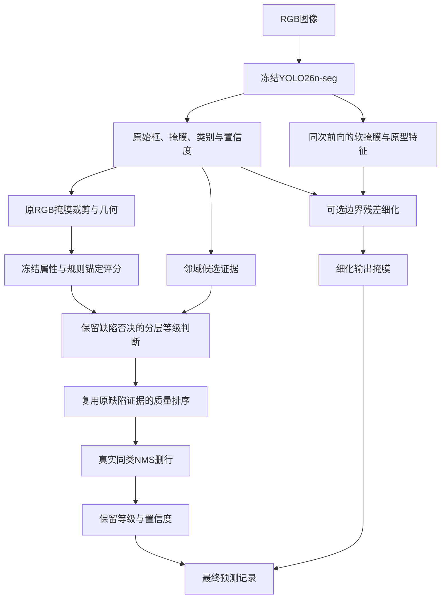
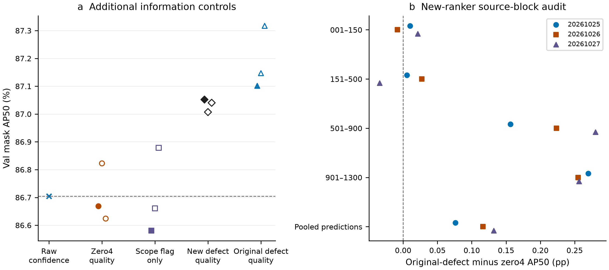
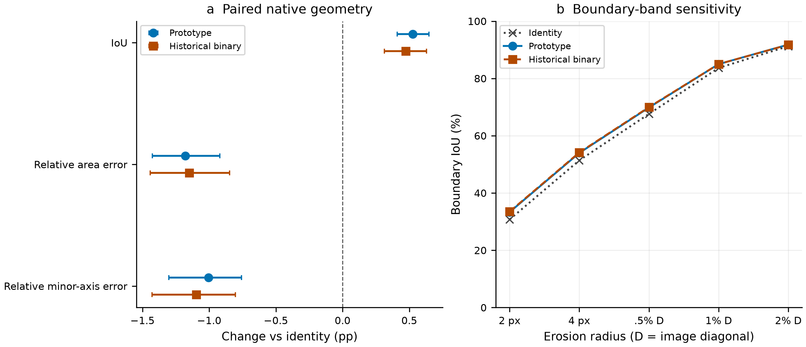
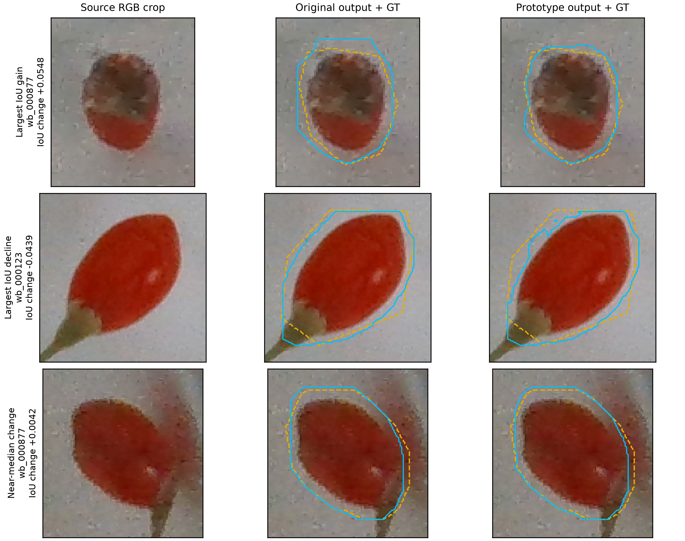
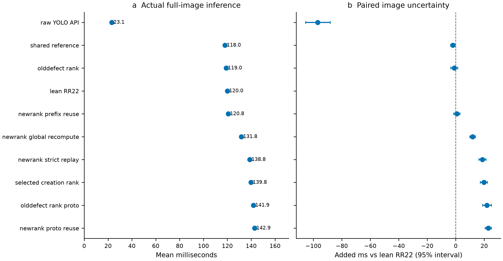

# 面向枸杞实例分割与外观分级的分层决策、质量感知排序及兼容掩膜细化方法

## 摘要

枸杞外观分级同时涉及缺陷否决、果梗状态和连续尺寸相关评分，最终等级具有非单调的分层语义。本文基于冻结的YOLO26n-seg检测器，将分层等级决策、预测质量排序与输出掩膜细化分别建模。以有界残差修正规则评分，利用邻域候选证据辅助果梗和等级边界判断，并复用原缺陷证据训练轻量质量排序头。输出细化支路利用同次检测前向的软掩膜和原型特征，保留原掩膜作为分级输入。实验包含966张训练图像、反复用于开发的116张验证图像，以及锁定方案后统一评价的129张测试图像、576个实例。在测试集上，主方案的Mask AP50由原YOLO的78.04%提高至80.72%，差值为2.68个百分点，图像配对95%百分位区间为1.43至4.08个百分点；相对RR22分层参考的增量为0.97个百分点，区间为0.27至1.70个百分点。已定位实例分级正确数由456/560提高至481/560。追加输出细化后，Mask AP50–95由68.03%提高至69.12%，但重新匹配后的分级正确数为480/560，显示保留候选标签并不保证评价匹配不变。测试结果支持该任务分解在现有划分上的收益；早期基线的历史test使用、混合标签来源及仅25个测试不合格实例，限制了独立泛化和商业分选结论。

关键词：枸杞；实例分割；外观分级；分层决策；质量排序；掩膜细化

## 1 引言

枸杞图像检测既需要区分单个果实，也需要明确哪些可见属性应当决定其等级。已有研究围绕枸杞采摘中的识别与定位展开[1]，也有研究关注干枸杞陈旧果掺杂检测[2]。相关农业视觉工作还涉及山竹尺寸与外观评估的集成[3]，以及基于分割的辣椒含杂率估计[4]。这些任务均需要将图像解释转化为下游决策，但具体判定对象并不相同。本文数据中的外观等级由缺陷状态、果梗状态和连续形态相关评分共同定义，研究范围是对这套候选分级规则的建模与评价，而非营养品质测定或商业标准认证。

Mask R-CNN[5]、YOLACT[6]及YOLO26软件体系[7]等实例分割方法，为同时获得单果掩膜与类别提供了基础。因此，可以直接训练一个预测不合格、一级、二级和三级的四分类实例分割器。然而，本项目的四类标签并不构成简单的尺寸顺序：缺陷果无论尺寸大小均属于不合格；其他合格果若缺梗，即使尺寸相关评分较高，也被划入三级。三级由此包含不同属性组合。将全部类别直接视为无条件有序等级，会丢失标签规则中的优先关系。

本文关注的问题是：在保持输出与属性依据可追溯的前提下，如何改进完整的实例分割与分级流程。基线在固定高置信操作范围内，已经以掩膜交并比不低于0.50定位了518个开发实例中的500个。因此，后续优化不仅需要关注是否检测到果实，还需要关注等级判定、候选竞争与轮廓质量。本文保留检测器，以显式模块处理这些下游环节，并分别检验其影响。

这一设计面临三个具体问题。其一，缺陷否决、果梗状态和尺寸边界的语义及错误代价不同。其二，重分类改变了预测类别，原检测置信度未必适合继续排序新的等级预测。Mask Scoring R-CNN[8]及质量感知目标检测研究[9]已经讨论了预测质量与分类分数的关系，本文进一步考察等级重分类后哪些既有信号仍然有效。其三，更准确的掩膜可能改变旧分级器使用的裁剪和几何输入。边界细化与边界敏感评价已有研究基础[10,11]，但分割指标改善能否传递到分级任务仍需实测。此外，sigmoid输出或平均精度提高均不足以证明概率已得到校准[12]。

针对上述问题，本文构建包含三个相互衔接部分的分层流程。首先，保留缺陷否决，结合果梗决策、连续评分有界残差及等级边界附近的候选证据完成分级；其次，以385个参数的排序头复用已有缺陷证据及紧凑预测元数据；最后，利用检测器同次前向中的软掩膜和原型特征建立可选输出细化支路。原掩膜继续为分级和排序提供输入，使呈现给分割评价的轮廓能够变化，同时避免无声改变旧分级器的输入表示。

本文的贡献是面向当前任务的系统集成及其受控评价。第一，显式表达异质分级规则，区分累计等级改善与后续排序改善。第二，通过信息来源对照检验原缺陷证据能否在不增加视觉适配的条件下辅助重分类排序。第三，将保持原分级输入的双掩膜设计，与细化后直接重评分及历史二值掩膜细化器分别比较。实验同时保留固定种子、信息消融、来源分组审计、图像配对不确定性、实际流程耗时和不利光照条件。开发实验用于方法构建和消融，锁定后的五组方案另在现有test划分上统一评价；两类证据分别报告。

## 2 相关工作

### 2.1 果品视觉检测、分割与下游测量

Wang等研究了非结构化光照条件下的枸杞特征识别与定位[1]，Huang等研究了干枸杞的陈旧果掺杂检测[2]。前者的采摘定位目标、后者的干果新鲜度目标，与本文含果梗规则的外观分级有所不同。Kusakunniran等研究了实例分割尺寸估计与多视角山竹外观评估的集成[3]；Lu等将辣椒实例分割、几何特征提取和含杂率预测联系起来[4]。这些工作提示，应当评价从分割结果到下游决策的完整链路，而不能假定不同果种、标签规则和成像条件中的性能数值可以直接迁移。

Mask R-CNN和YOLACT是具有代表性的实例分割方法[5,6]，本文采用的检测器实现来自YOLO26[7]。本文保留既有任务训练检查点，重点研究其输出与独立分级器之间的兼容关系。所提出流程不属于新的YOLO主干架构，现有实验也不足以得出优于所有现有实例分割网络的结论。

### 2.2 质量感知排序与概率校准

Mask Scoring R-CNN研究了分类置信度与掩膜质量之间的不匹配[8]；Generalized Focal Loss研究了定位质量与分类的联合表示[9]。这些工作与本文的共同关注点，是区分类别判断与预测质量排序。本文在外观等级确定之后定义质量监督，输入中包含已经存在的缺陷估计，进一步比较有用信息是否必须来自新视觉适配。

概率校准关注预测概率与实际正确频率的一致性[12]。本文排序目标为多个掩膜IoU阈值下兼容性的均值，输出还与原检测置信度相乘。因此，本文采用“质量排序”这一表述，不把二元交叉熵训练、sigmoid输出或AP改善直接解释为正确概率已校准，也不据此宣称已经建立安全拒绝机制。

### 2.3 边界细化及其下游兼容性

PointRend从点式渲染角度研究高质量图像分割[10]，Boundary IoU研究面向轮廓质量的分割评价[11]。这些方向为利用细粒度信息和在AP50之外检查几何保真度提供了依据。本文采用检测器原型特征驱动的密集逐点残差头，并非完整复现PointRend。本文重点检验的是表示兼容：保持原分级输入，同时细化最终分割输出。该选择来自实际观察，即轮廓重叠改善后，将新掩膜直接送入旧评分器并不总能改善分级。

## 3 材料与方法

### 3.1 数据、标注与候选分级规则

实验使用966张原始训练图像、4,277个标注实例，以及116张验证图像、518个实例。由于后者在方法开发期间反复被使用，本文称其为开发集。针对新增模块，原训练图像按图像划分为773张拟合图像和193张内部留出图像。同图果实及其衍生视图始终属于同一角色。原检测器和早期分级组件已经见过原训练总体，因此该内部留出不构成整个系统完全未见数据的评价。

表1 train/val多任务目标清单与核验后test标签清单中的图像和实例分布。

| 划分 | 图像数 | 不合格 | 一级 | 二级 | 三级 | 实例合计 |
|---|---:|---:|---:|---:|---:|---:|
| 原训练集 | 966 | 372 | 945 | 1,138 | 1,822 | 4,277 |
| 开发集 | 116 | 54 | 109 | 150 | 205 | 518 |
| 最终测试集 | 129 | 25 | 126 | 167 | 258 | 576 |
| 新增模块拟合角色 | 773 | — | — | — | — | 属于原训练集 |
| 新增模块内部留出角色 | 193 | — | — | — | — | 属于原训练集 |

后两行是原训练集内部的角色划分，不应再与原训练集相加。本文总体对照不依赖这两个角色的逐类实例合计。

人工实例轮廓用于几何特征提取，缺陷和果梗审核形成属性依据，部分最终等级由冻结的可解释规则生成。因此，连续目标是规则派生评分，并非独立专家对整体品质的连续打分。缺失的属性标签不参加对应监督，不作为负类填入。

冻结配置中，面积百分位、短轴百分位与形态评分的权重分别为0.7、0.1和0.2。颜色均匀性保留为描述性特征，但在该配置中的直接等级权重为0。两个评分阈值分别为37.40298225745565和65.62684031710077。缺陷果首先判为不合格；其他合格果若缺梗，判为三级；其余果实按照高、低阈值分为一级、二级或三级。这一规则决定了三级的异质性。

当前长度单位为像素，面积单位为像素平方，尚无可靠的像素—毫米标定，因而不能据此声称符合物理尺寸商业标准。终测核验确认test为129张图、576个实例：302个实例为双人审核一致，51个由负责人手工裁决，223个沿用冻结基础规则。历史582个审核条目中，6个重复多边形在原导出阶段删除，本次未更改标签。val采用仅修订7个类别标签、保留多边形坐标的单人复核覆盖版本；test使用原v3标签。早期基线曾在test上评估，后续新增模块未用test拟合或选点；锁定后完成本次统一测试，不能把该划分称为从未访问过的外部测试集。

### 3.2 冻结检测器与分层属性表示

检测器使用既有离线增强200轮协议得到的YOLO26n-seg检查点，训练种子为20260915，启用end-to-end输出头。原训练过程使用由966张原图形成的2,898张交付训练图，关闭在线尺度变化和组合增强；这些衍生图像不代表额外独立采集果实。本文在当前标注版本上重新评价冻结检查点，不将旧标注版本下的历史训练日志数字替代当前重放结果。

独立分级器接收缩放填充至160×160的RGB加掩膜四通道裁剪，以及六项掩膜/裁剪几何描述。视觉通道依次为32、64、128、192和256，随后进行全局池化；几何网络将六维输入映射至32维。两路拼接后融合为256维表示，接缺陷、缺梗和连续评分输出。紧凑排序候选使用冻结的这一既有表示。

研究主方案实际上保留原检测类别中的“不合格”作为缺陷否决，原属性头的缺陷logit用于排序，不在主方案中替换为新的缺陷门控。对原始高置信合格候选，再进行果梗与连续评分判定。低置信候选保留在AP候选池中，但不执行重新分级；属性无效时回退到原检测类别。

图1 处理流程及分级表示与输出分割的分离。

细化掩膜不回流至分级或排序特征。各输出字段通过原预测索引保持对应。

### 3.3 规则锚定残差评分与局部决策证据

本文区分原有学习评分、由预测掩膜特征直接计算的冻结规则评分，以及规则评分加有界学习残差三种评分来源。最后一种作为RR22参考的评分组件。RR22是实验简称，不是新的检测器架构；本文所称完整RR22参考还包含边界/果梗邻域决策和真实同类NMS。

对于冻结融合特征$f$及拟合角色统计量$\mu,s$，已实现的规则锚定残差为

$$
\widehat q=100\,\operatorname{clip}\left(q_{\mathrm{rule}}/100+0.05\tanh h_\theta((f-\mu)/s),0,1\right).
$$

其中$q_{\mathrm{rule}}$为直接规则评分，$h_\theta$为256→32→1多层感知机，隐藏层采用SiLU，末层零初始化。裁剪前残差范围为正负5个评分点。原评分训练包含3,053个拟合实例和761个内部留出实例。采用AdamW，学习率0.001、权重衰减0.001、batch 128、最多60轮、内部留出MAE早停耐心12轮。目标由归一化评分的Smooth L1损失、尺寸任务条件下的有序辅助损失以及残差平方约束组成。原规则锚定实验未通过其预设MAE实用改善门槛，后来将其作为级联参考属于探索性流程选择，不能改写此前门槛结果。

局部证据在box IoU不低于0.85的候选邻域内，对每个原类别取其top-class置信度最大值，缺失类别填$10^{-4}$。该四维向量来自多个邻域候选的汇聚，与同一候选本身的真实四类输出不同。后者在前阶段已经于检测top-k之前独立捕获，并与候选索引对齐。两类向量均不保证和为1，也不能直接称为已校准的后验概率。主策略使用邻域向量，不能把提取同候选四类分布本身写成最终改善的全部来源。

边界融合只在阈值附近调整尺寸判定。对评分阈值$T$、对应相邻类别的logit差$d$，已实现的修正边距为

$$
m_T=\widehat q-T+\lambda\exp\left[-\tfrac12((\widehat q-T)/\sigma)^2\right]\tanh(d/3),
$$

其中$\lambda=1.5$、$\sigma=2.5$。根据高、低阈值修正后的边距确定尺寸等级。缺梗判断在原缺梗logit上，加入0.5倍的“邻域三级证据减去一级、二级较大证据”，结果非负时判为缺梗并分入三级。不合格否决位于上述判断之前。主候选不启用将原不合格预测恢复为合格等级的操作。

### 3.4 质量排序与真实重复抑制

重分类可能使多个候选竞争同一最终等级。当前检测器运行end-to-end输出路径，不能假定传统class-offset NMS已经消除了所有原始同类碰撞。因此，对原YOLO同时给出追加相同NMS与不追加NMS两种对照。

真实NMS在相同最终类别内使用box IoU 0.70。原始置信度不低于0.25的候选优先于低置信候选；各范围内按排序分数和稳定索引处理。该范围优先规则是显式的评价协议选择。抑制后同时从框、掩膜、类别、置信度和相关元数据中删除对应行，再重新匹配；仅降低重复候选分数不视为删除。该方法也不等于已经为所有跨类残余候选建立唯一物理果实身份。

排序器包含18项核心特征与4项附加通道。核心信息包括原置信度、果实评分及距阈值的距离、缺梗证据、归一化掩膜与框几何、原始/最终类别指示和邻域类别logit。原缺陷版本增加原缺陷logit除以10、归一化二元熵、可用标记和一个零通道。标准化仅使用排序拟合预测。网络为22→16→1，隐藏层SiLU，共385个分配参数。零通道对照保持分配架构相同，但不具有相同的有效信息容量。

记候选$i$与相同最终类别训练GT的最大掩膜IoU为$v_i$，不存在兼容GT时取0。独立多IoU目标为

$$
y_i=\frac{1}{10}\sum_{t\in\{0.50,0.55,\ldots,0.95\}}\mathbf{1}(v_i\ge t).
$$

该逐候选目标不将一个GT独占分配给一个预测，重复竞争在后续真实NMS中处理。排序训练采用二元交叉熵、AdamW，学习率0.003、权重衰减0.0001、batch 256、最多300轮，内部留出损失早停耐心30轮，允许选择第0轮。对最终非零类别，以sigmoid排序输出乘原检测置信度；最终类别0保留原置信度。是否处于分级操作范围始终由原始置信度≥0.25定义。

对照包含附加四维置零、仅可用标记、新训练缺陷证据，以及原缺陷证据。新属性家族在查看相应开发结果之前完成内部筛选；原缺陷证据组则是在已有反馈后追加的适应性机制对照，随后冻结为本次最终测试的主方案。主结果固定种子为20261025，不以开发集上更好的其他种子替换。

### 3.5 保持分级输入兼容的输出掩膜细化

细化支路捕获检测器同次前向的阈值前掩膜信息和32通道原型特征。RGB、单通道粗掩膜及原型构成36通道输入，经过36→32→16→1的逐点卷积头，层间使用SiLU，末层零初始化，残差幅值为$6\tanh(\cdot)$。采用硬/软粗掩膜与零/真实原型的二乘二对照，各组均保留RGB。

训练使用160×160裁剪，原型特征插值至该网格。预测残差再双线性映射回原图裁剪，只在原始二值掩膜固定4像素边界带内叠加于−2/+2的原始二值logit，并以0阈值输出。因此，零残差严格恢复原掩膜，不以低分辨率粗掩膜放大替代原分割。损失包括边界加权二元交叉熵和Dice项。采用AdamW，学习率0.001、权重衰减0.0001、batch 32、最多30轮、早停耐心8轮，根据内部原图IoU及相对面积误差选择检查点。额外运行所有组固定30轮的对照，检查早停剂量差异是否影响二乘二比较。

原图union和面积误差的GT分母包括裁剪范围外的完整GT面积。输出支路方案继续使用原掩膜进行分级和排序，只把细化掩膜用于最终分割输出；另设完整重评分分支，将细化掩膜重新送入旧分级器，作为兼容性对照。

## 4 实验设计

### 4.1 评价终点与操作范围

全流程AP分别使用开发集116张图像或测试集129张图像的全部GT，以及原检测置信度低至0.001的预测池，max_det为300，输入尺度640，FP32，保留原图分辨率掩膜。类别感知匹配覆盖IoU 0.50:0.05:0.95，AP通过封存的Ultralytics匹配与AP实现计算；阈值范围采用COCO官方评价惯例[13,14]。本文不声称与任意其他COCO评价实现逐字节一致。

分级操作范围为NMS后原置信度≥0.25的预测。先以掩膜IoU≥0.50进行类别无关最优匹配，定义已定位实例，再判断等级是否正确。分别报告正确分级数/定位数与正确分级数/全部GT。操作点macro-F1同时考虑该范围内类别感知的误检和漏检。定位匹配后正确分级数449，与AP计算中的类别感知真阳性数不是同一统计量。

风险终点包括：匹配到的不合格GT被判为合格等级、匹配到的合格GT被拒为类别0，以及原先正确拒绝的不合格个体新增误放。另设输出暴露诊断：只要不合格GT与任一保留高置信合格预测的mask IoU≥0.50，即记录一次存在合格输出，即使另一个候选已与其匹配。该项不等于一对一匹配错误数，也不等于已核实的物理单果最终决定。

### 4.2 重复拟合、来源分组与不确定性

最近阶段完成150次优化拟合，涉及属性头、评分头、排序器和掩膜细化器，没有新训练YOLO。更早阶段保留各自实验清单，拟合次数不作为独立数据集数量。新建排序/细化头跨种子改变初始化与小批顺序；预训练属性变体从同一原权重起步，跨种子主要改变样本顺序。

使用001–150、151–500、501–900和901–1300四个编号范围作为来源代理组，尚未确认其对应独立采收批次或不同实物果总体。排序器来源留出审计将外层组排除于新增排序器拟合、归一化和选点，但早期冻结组件已经见过原训练集。外层预测拼接后重新计算总体AP，不对四个来源AP直接取平均。

固定排序对比采用2,000次按四来源分层的整图配对bootstrap，同图果实始终一起抽样，抽样图索引排序以保留置信度并列时的顺序。区间为逐项95%百分位区间，未校正反复开发、适应性比较或多重检验；三个优化种子也不是三套独立数据。因此，这些区间用于探索性描述，不作为确认泛化的统计证明。

### 4.3 计算环境与时间测量

实验环境为Windows、Python 3.12.14、PyTorch 2.13.0+cu130、Ultralytics 8.4.117，GPU为NVIDIA GeForce RTX 5070 Laptop GPU。矩阵乘法TF32关闭，CuDNN TF32开启。最近阶段开始前，安装环境中的原图掩膜处理已包含内存分块补丁，精确源码和哈希已归档，不能称为完全未修改的官方安装。

最近计时选取24张开发图像，每来源6张，每图3次，图内随机安排执行图顺序，计时前后GPU同步。排除图像解码与模型加载，包含置信度池0.001下实际检测、分级、排序和相关后处理。使用不同候选池或实现的历史时间仅在自己的同轮对照中解释，不与最新耗时表拼接。

### 4.4 冻结方案的最终测试协议

在终测推理前核验图像、标注来源、实例行号、模型/配置哈希与运行环境，并用完整val重放五组方案；110项指标与封存结果完全一致。固定方案为原YOLO、原YOLO＋同类NMS、RR22、原缺陷排序主方案及主方案＋输出细化，固定报告种子20261025。使用同一个冻结检测前向产生各方案所需预测，推理不接收GT；保存预测后按统一口径评价。未依据test结果改变模型、阈值、NMS或方案角色。

主终点延续测试前冻结协议，为主方案相对RR22的Mask AP50差值；其余指标与原YOLO对照作为次要结果完整报告。test区间采用2,000次按四个既有来源范围分层的整图配对bootstrap，随机种子20261027。方案和主终点在测试前冻结；具体重采样参数在查看测试点估计后、计算区间前记录，因此不描述为前瞻注册的完整统计分析。报告逐项95%百分位区间，不作多重检验校正或显著性星号推断。重采样始终保留同图全部实例，并保持跨方案相同的图像重复次数；2,000次抽样均包含四类GT。

连续评分、缺陷及果梗的独立test目标尚未核实，故不报告相应test MAE或属性准确率。共享前向终测的总运行时间包含GT读取、IoU计算与文件保存，不作为单方案推理延迟；速度对照仍使用第5.5节开发图像上的独立计时。

## 5 实验结果

### 5.1 开发集完整流程对照

表2汇总固定种子的最新结果及前阶段相同协议的分级强对照。分层参考相对直接检测器提高了正确分级数；最近排序进一步改变AP，但正确分级数不变。原YOLO追加同等NMS的对照，则揭示共享重复删除操作的收益。

表2 开发集分割与分级结果。AP单位为百分比。各行在固定原始置信度操作范围内均定位500/518个GT。历史分级对照采用共同全GT/NMS协议，不混入其历史耗时。

| 方法 | Mask AP50（%） | Mask AP50–95（%） | 正确/定位 | 条件准确率（%） | 正确/全部GT（%） |
|---|---:|---:|---:|---:|---:|
| 原YOLO26n-seg | 83.48 | 70.21 | 416/500 | 83.2 | 80.31 |
| 原YOLO26n-seg＋真实NMS | 84.15 | 70.68 | 416/500 | 83.2 | 80.31 |
| 原R1＋自有排序＋同等NMS | 85.33 | 71.62 | 439/500 | 87.8 | 84.75 |
| 学习残差＋自有排序＋同等NMS | 85.76 | 71.89 | 442/500 | 88.4 | 85.33 |
| 直接规则＋自有排序＋同等NMS | 85.38 | 71.75 | 443/500 | 88.6 | 85.52 |
| 直接规则＋边界/果梗证据＋同等NMS | 86.52 | 72.56 | 450/500 | 90.0 | 86.87 |
| RR22分层参考 | 86.70 | 72.72 | 449/500 | 89.8 | 86.68 |
| RR22＋历史18维排序 | 86.69 | 72.73 | 449/500 | 89.8 | 86.68 |
| 新缺陷质量排序，内部选定 | 87.05 | 73.24 | 449/500 | 89.8 | 86.68 |
| 原缺陷质量排序，固定seed25 | 87.10 | 73.29 | 449/500 | 89.8 | 86.68 |
| 原缺陷排序＋输出细化 | 87.10 | 74.23 | 449/500 | 89.8 | 86.68 |

最终配置相对原YOLO的累计AP50增加3.62个百分点，相对同等追加NMS的原YOLO增加2.95个百分点。其中，原缺陷排序相对RR22新增0.40个百分点，不能将累计收益全部归因于该排序头。直接规则加边界/果梗方案在此集合上比RR22多判对1个实例，说明当前选择并非在所有指标上均优于所有对照。

表3 前阶段固定评分比较，尚未加入后来的共同NMS及边界证据。MAE对应448个有规则评分目标的实例，耗时只属于该历史阶段同24图×5次的联合测量。

| 前阶段配置 | 正确/500 | 规则评分MAE（分） | 平均耗时（ms/图） |
|---|---:|---:|---:|
| 原R1＋自有排序 | 439 | 2.1397 | 53.75 |
| 选定学习残差＋自有排序 | 442 | 2.0274 | 54.51 |
| 直接规则＋自有排序 | 443 | 1.9261 | 65.56 |
| 规则锚定残差＋自有排序 | 443 | 1.9092 | 66.19 |

该历史比较体现了学习残差的速度与规则评分误差权衡：直接规则及规则锚定的MAE点值更小，而学习残差耗时较低。该结果不能说明最终RR22流程仍以54.51 ms/图运行，也不能改变规则锚定残差未通过原实用门槛的事实。

### 5.2 排序信息来源与不确定性

表4分离附加信息的作用，各行观察到的正确分级数均为449/500。三个种子中，原缺陷证据均优于仅可用标记对照；获得该AP改善不要求重新训练视觉缺陷尾块。

表4 RR22原输出掩膜下的排序对照。AP单位为百分比。历史18维排序固定seed20261024，其余新增单值行固定seed20261025；跨种子范围另行列明。

| 排序变体 | Mask AP50（%） | Mask AP50–95（%） | 选择身份 |
|---|---:|---:|---|
| 原始置信度 | 86.7046 | 72.7225 | 固定RR22参考 |
| 历史18维排序 | 86.6942 | 72.7307 | 前阶段内部选择 |
| 18维核心＋四维零，多IoU目标 | 86.6691 | 72.7510 | 配对信息对照 |
| 18维核心＋仅可用标记 | 86.5808 | 72.7411 | 追加机制对照 |
| 18维核心＋新缺陷证据 | 87.0522 | 73.2362 | 内部选定新家族 |
| 18维核心＋原缺陷证据 | 87.1013 | 73.2874 | 追加对照，随后冻结 |
| 原缺陷，seed25/26/27 | 87.1013 / 87.1468 / 87.3170 | 73.2874 / 73.2936 / 73.4414 | 保留全部重复 |

固定原缺陷排序相对RR22的AP50差为+0.397个百分点，探索性95%区间为[−0.141,+0.959]；AP50–95差为+0.565个百分点，区间为[+0.013,+1.045]。相对同目标零信息对照，AP50差为+0.432个百分点，区间为[+0.028,+0.782]。这些逐项区间均未校正适应性追加家族和反复开发；相对RR22的主要AP50区间包含0。

逐一排除一个开发来源后，AP50点增益约为+0.33至+0.62个百分点。在原训练集上的新增排序器来源留出审计中，原缺陷组拼接AP50为97.35%至97.38%，零附加组为97.23%至97.27%。这些高值只审计原训练总体中的新增排序器，不是整个系统在独立来源上的泛化成绩。

图2 排序信息来源及新增排序器来源留出审计。实心点表示固定seed25，其余点保留其他种子。原缺陷组属于适应性机制对照；来源审计的上游冻结组件已见过原训练数据，不能将该面板解释为全系统分布外测试。

### 5.3 输出细化与分级兼容性

内部选出的软掩膜/原型家族改善了相对原掩膜的原图IoU和面积误差，但将其直接送入旧分级器不能稳定保持完整流程结果。表5分别比较输出细化、完整重评分，并保留历史二值细化器作为强对照。

表5 RR22原始置信度下的掩膜与兼容性对照，不启用新增缺陷排序。新模型固定seed25，历史二值模型固定seed23。几何评价使用原始固定500个匹配，平均相对误差无量纲；几何列只描述掩膜，与是否重算分级无关。

| 掩膜/输出策略 | Mask AP50（%） | Mask AP50–95（%） | 正确/定位 | 平均IoU | 相对面积误差 | 相对短轴误差 |
|---|---:|---:|---:|---:|---:|---:|
| 原掩膜 | 86.70 | 72.72 | 449/500 | 0.91390 | 0.05532 | 0.04285 |
| 历史二值细化，仅输出 | 86.70 | 73.87 | 448/500 | 0.91863 | 0.04381 | 0.03189 |
| 软掩膜＋原型，仅输出 | 86.70 | 73.70 | 449/500 | 0.91917 | 0.04354 | 0.03281 |
| 软掩膜＋原型，完整重评分 | 86.40 | 73.45 | 448/500 | 0.91917 | 0.04354 | 0.03281 |

“仅输出”固定的是候选类别及排序输入，并不保证更换掩膜后重新匹配得到的条件计数完全相同。历史模型改变了匹配结果，得到448个正确分级、11个合格误拒；新原型输出方案在此对照中保留449个正确和10个误拒。另一方面，历史模型的AP50–95点值更高，短轴误差更低，因而不能声称新原型头在所有分割指标上全面优于历史对照。

与原缺陷排序组合后，原型输出方案的AP50–95达到74.23%，相同排序器使用原掩膜时为73.29%；AP50和观察到的正确分级数不变。二乘二实验及固定30轮扩展支持当前设计中原型信息的作用，但零原型通道对照不构成有效容量完全相等的模型。

图3 原图掩膜几何与边界宽度敏感性。几何队列在细化之前固定；Boundary IoU同时保留固定像素半径及相对图像对角线的带宽，并纳入历史强对照。人工多边形属于图像标注，不是物理计量真值。

图4 固定队列中的改善、退步和接近中位数案例。按基于GT的IoU变化选择，仅用于说明，保留原始RGB像素，不表示具有代表性的成功率，也不表示推理使用GT。

### 5.4 操作点错误与输出暴露

原YOLO的操作点macro-F1为77.48%，追加真实同类NMS后为78.27%，RR22及选定排序/输出变体为84.37%。定位数仍为500/518。最终51个已定位分级错误与18个未定位GT分别统计，不能由任一计数直接推出AP。

54个不合格GT中定位52个，主配置有21个匹配实例被判为合格等级；另有10个已定位合格果被判为不合格。最终排序/输出变体相对固定主参考未新增误放个体，但有24个不合格GT与至少一个保留高置信合格输出重叠。因此，保留原类别0门控并不等于已经建立安全的物理分选策略。

主配置也没有获得所有探索中最高的正确分级数。另一个经过解析先验修正的追加不合格策略在seed25得到451/500、19个不合格误放和10个合格误拒，其他两个种子为450/500；该策略不是内部选出的主要缺陷策略。同种子下未修正原始版本为448/500和15个合格误拒。本文保留这一区别，不把开发计数较大的探索版本包装为独立验证的主模型。

### 5.5 实际推理成本

表6 最新同轮实测耗时，置信度池0.001，24图×3次，排除解码和模型加载。共享参考采用与紧凑排序相同的基线特征路径，lean参考则是另一RR22执行实现。

| 实际执行图 | 平均耗时（ms/图） |
|---|---:|
| 原YOLO API | 23.11 |
| lean RR22参考 | 120.02 |
| 共享计算RR22参考 | 118.01 |
| 原缺陷质量排序 | 119.01 |
| 原缺陷排序＋输出细化 | 141.92 |
| 新缺陷排序，严格重放路径 | 138.79 |
| 新缺陷排序，显式前缀复用 | 120.79 |

原缺陷排序相对匹配的共享计算参考增加约1.00 ms/图，输出细化继续增加可见成本。完整分级流程仍显著慢于单独检测API。由于重新组织视觉批量会产生浮点差异，严格重放与前缀复用保持为不同执行图，不宣称逐位相同。

图5 同设备实际计时及图像配对区间。计时包含相关检测、属性、排序和细化操作，重复次数是同24张图像的重复测量，不是独立图像数量。

### 5.6 负结果与压力条件

早期同训练剂量的检测器适配中，测试的方向性或部分通道模块未显示超出匹配control的优势。某些原生检测指标提高的模型，接入冻结分级级联后反而退步。这支持在上游选模时同时评价表示兼容性，但不能推出联合重训练或其他检测适配永远无效。

表7 固定原缺陷排序的部分不利条件。各条件均包含相同518个GT，并对实际变换图像重新预测；条件分母随定位变化，正确/全部GT采用共同分母。

| 合成条件 | 正确/定位 | 正确/全部GT（%） | Mask AP50（%） |
|---|---:|---:|---:|
| 正常图像 | 449/500 | 86.68 | 87.10 |
| 全图亮度×0.70 | 266/498 | 51.35 | 63.10 |
| 全图偏色 | 216/498 | 41.70 | 47.21 |
| 背景偏色 | 328/492 | 63.32 | 70.68 |
| 前景偏色 | 172/484 | 33.20 | 47.42 |
| 前景暗光＋背景偏色 | 147/488 | 28.38 | 37.73 |

前景/背景变换使用预测前景而非GT掩膜，属于合成诊断，不是真实部署数据。实验报告保留全部十条件矩阵。质量排序不能修复这些条件下大量已判错的等级。纯二值几何评分在部分暗光条件下改善计数，却使正常图正确数降至约404–408，未通过内部替换条件。空间分支选择器也存在正常图与特定干预条件之间的权衡。

GT代入诊断表明属性与边界融合错误存在交互。即使代入GT属性，邻域边界融合仍可将11个原本正确的临界判定翻错。这些结果用于诊断冻结逻辑，不是可达到的模型成绩、物理上限或运行时使用GT的证据。它们指出可靠度控制的边界融合作为后续问题，不能额外计为已验证贡献。

### 5.7 冻结方案的最终测试结果

表8 统一冻结协议下的test结果，129张图像、576个GT。五组均定位560个实例；AP与百分比指标以百分数表示。

| 固定方案 | Mask AP50 | Mask AP50–95 | 分级正确/定位 | 条件分级正确率 | 正确/全部GT | 操作点宏F1 |
|---|---:|---:|---:|---:|---:|---:|
| 原YOLO26 | 78.04 | 65.84 | 456/560 | 81.43 | 79.17 | 72.56 |
| 原YOLO26＋同类NMS | 78.89 | 66.46 | 456/560 | 81.43 | 79.17 | 73.54 |
| RR22分层参考 | 79.75 | 67.16 | 481/560 | 85.89 | 83.51 | 77.79 |
| 原缺陷排序主方案 | 80.72 | 68.03 | 481/560 | 85.89 | 83.51 | 77.79 |
| 主方案＋输出细化 | 80.72 | 69.12 | 480/560 | 85.71 | 83.33 | 77.79 |

主方案相对原YOLO的AP50累计提高2.68个百分点，低于开发集的3.62个百分点。与使用相同额外NMS的原YOLO相比，增量为1.83个百分点。相对RR22的排序增量为0.97个百分点，分级正确数不变；原YOLO至RR22的分层处理增加25个正确分级实例。整个流程与各模块的增量由不同对照归因。

表9 test的图像配对95%百分位差值区间，单位为百分点。逐项区间用于描述，未作多重检验校正。

| 固定对照 | 指标 | 点估计 | 95%下限 | 95%上限 |
|---|---|---:|---:|---:|
| 同类NMS−原YOLO | AP50 | 0.85 | 0.61 | 1.10 |
| RR22−同类NMS原YOLO | AP50 | 0.86 | -0.50 | 2.34 |
| 主方案−RR22（主终点） | AP50 | 0.97 | 0.27 | 1.70 |
| 主方案−原YOLO | AP50 | 2.68 | 1.43 | 4.08 |
| 主方案−同类NMS原YOLO | AP50 | 1.83 | 0.64 | 3.16 |
| 输出细化−主方案 | AP50–95 | 1.09 | 0.63 | 1.67 |

主终点区间为0.27至1.70个百分点，累计对原YOLO的区间为1.43至4.08个百分点。RR22相对同NMS原YOLO的AP50区间跨零，故不将所有逐模块AP差值都解释为已获独立统计确认。四个来源代理组的分级正确数均高于原YOLO，但这些组不构成已核验的独立采收总体。

输出细化使AP50保持80.72%，AP50–95由68.03%提高至69.12%，差值1.09个百分点，区间为0.63至1.67个百分点。其候选等级、排序与保留行不变，但在实例wb_000911__i001上，类别无关匹配从三级候选行1切换为不合格候选行2；细化后的后者IoU更高，导致正确分级数由481降至480、匹配误拒由37增至38。该负结果说明双掩膜设计保持分级输入，却不保证重新匹配后的评价正确数恒定。

全部25个不合格GT均被定位，五组均有2个匹配漏放、3个不合格GT与至少一个保留合格输出重叠。主方案与原YOLO均误拒37个已定位合格果，输出细化为38个；相对RR22新增不合格漏放为0。匹配漏放2/25为8%，同样本上的零新增差值不能解释为零绝对风险或总体等效。不合格类别AP仍明显低于各合格等级（附录表A4）。

## 6 讨论

### 6.1 累计改善的正确归因

单一AP数值会混合三个机制：分层决策改变等级，质量排序改变候选顺序及竞争，输出细化改变轮廓几何。当前开发集上，最近排序改善AP而未改变分级准确率，更大范围的累计流程则相对直接检测器同时改善分级与AP。相同NMS的原YOLO对照进一步显示了重复删除的作用。因此，各组件应依据其匹配对照分别归因。

排序贡献的定位应窄于一个全新的通用评分范式。质量感知掩膜评分和检测已经存在相应研究[8,9]。本项目有价值的发现是，分级表示中已经存在的原缺陷信息，可通过较小附加头支持重分类后的质量排序。这不能说明新视觉训练在所有任务中都不必要，只说明当前配置的正常开发集AP增量不要求新增视觉适配；它也不证明输出已满足预测概率与正确频率一致的校准含义[12]。

### 6.2 更准确的掩膜为什么还需要兼容性检验

旧评分器依赖掩膜几何和裁剪统计，更换掩膜即改变其输入分布，即使掩膜重叠更高也可能如此。观察到的重新评分退步与这一兼容性解释一致。将原掩膜留给分级、细化掩膜用于输出，可以避免把新表示直接强加给尚未适配的旧评分器。双掩膜因此是一项显式系统接口选择，而不是分割与分级互不相关的证据。

该设计的代价是额外掩膜处理，以及必须按候选索引保持对齐的两套表示。历史细化器在若干轮廓指标上仍有竞争力。未来可以检验针对细化几何重新训练评分器，但现有数据没有证明该扩展有效。本文当前贡献是对既有冻结组件下兼容策略的评价。

### 6.3 标签效度与泛化边界

部分参考等级来自与直接规则预测同族的可解释测量，因此高一致率在一定程度上衡量对预定义流程的复现，不能直接验证营养品质、市场价值、独立专家共识或国家商业等级。人工轮廓和属性复核加强了标注依据，但不消除这一性质差别。若要评价独立商业品质，需要独立定义的目标；若要报告物理尺寸，还需要完整标定。

开发集反复使用与历史test使用共同限制统计解释。原缺陷排序是在适应性机制对照后冻结的方案，逐项bootstrap无法消除这一选择历史；本次锁定后test结果提供现有划分上的补充证据，但不等同新采集外部验证。冻结检测器来自单条历史训练运行，新增模块的三个种子不能估计整个系统训练变异。跨train/val/test未见字节完全相同的图像，也不能排除同一实物果、相邻帧或采集批次共享。测试标签中223/576沿用冻结规则，且不合格实例仅25个；这些因素限制独立品质目标及风险估计精度。

光照失败进一步限制部署表述。在定位仍相对较高时，合成测试已暴露出明显分级敏感性。本文不包含完成的水流装置试验、在线自动分选验证或多地点独立评价。匹配口径误拒/误放也未解决多个跨类候选如何形成唯一物理单果动作的问题。较低AP错误或本val新增误放为0，不能替代明确的物理输出与拒绝策略。

### 6.4 锁定测试后的解释与后续边界

已在统一冻结标注和指标协议下完成五组方案的最终测试，保留报告种子、置信范围、NMS、等级阈值及排序公式。主方案相对原YOLO和RR22的AP50差值区间均位于零以上，但区间是对本划分的逐项描述，不能据此消除标签同源、历史测试使用或实物果关联。输出细化增加严格IoU平均AP，同时出现一个匹配分级错误增量，应将该权衡作为兼容性分析的一部分。现有test完成后不继续依据该集选择新方案；额外独立采集组属于未来外部效度工作。

后续方法研究应直接针对已观察到的失败：真实光照条件下可靠的果梗/缺陷证据、证据冲突时可暂缓融合的边界策略，以及考虑竞争等级的物理单果输出规则。这些属于建议开展的后续工作，不作为本文已经完成的效果改善。

## 7 结论

本文构建并评价了符合缺陷、果梗及尺寸候选规则优先关系的模块化枸杞外观分级流程。方法重点是分离等级赋值、预测质量排序与输出掩膜几何，并显式检查各环节之间的兼容性。复用原缺陷证据提供了附加成本较小的排序选择，输出细化支路则保留了既有分级输入。

在129张测试图像上，主方案取得80.72%的Mask AP50，相对原YOLO提高2.68个百分点；分级正确数由456/560提高至481/560。输出细化将Mask AP50–95提高至69.12%，但重新匹配后的正确数为480/560。开发消融与锁定测试共同支持分层决策、缺陷证据复用排序及输出掩膜兼容性检查的应用价值。标签来源、早期test使用、不合格样本数量和光照/物理输出失败模式仍限制结论，现有证据不足以宣称自动商业分选可靠性。

## 附录A 特征与报告细节

表A1 项目保留的18项可解释描述特征。它们不同于原分级器的六项几何输入及排序器的22通道。

| 特征组 | 字段 | 单位 |
|---|---|---|
| 尺寸与形态 | 长轴、短轴、面积、长宽比、圆度、实心度、偏心率 | px、px、px²，其余无量纲 |
| 颜色 | Lab L均值/标准差、a均值/标准差、b均值/标准差，HSV S均值、V均值 | L为0–100；a/b为近似有符号Lab尺度；S/V为0–1 |
| 候选损伤 | 暗区比例、异常色比例、最大连通损伤比例 | 无量纲 |

损伤字段描述图像候选区域，不是独立微生物或理化腐烂测量。原项目定义中，前两项与最大连通损伤项采用不同有效区域分母，不能无声统一或互换。

表A2 排序输入通道分配。

| 通道 | 输入内容 |
|---|---|
| 1–8 | 原检测logit、评分/100、距最近尺寸阈值距离/100、缺梗logit/10、log掩膜面积比例、log框面积比例、log框长宽比、最终与原类别一致标记 |
| 9–11 | 最终一级/二级/三级指示 |
| 12–14 | 原始一级/二级/三级指示 |
| 15–18 | 四类邻域证据logit/10 |
| 19–22，原缺陷方案 | 原缺陷logit/10、二元熵/log 2、可用标记、零通道 |

原分级器的六项几何描述为log变换的掩膜面积、宽、高、裁剪宽、高，以及未取log的掩膜/裁剪面积比。该表示和排序表示使用各自记录的拟合总体统计进行归一化。

表A3 当前主表固定配置的分类别开发Mask AP50/AP50–95，单位为百分比。

| 类别 | 原YOLO | RR22 | 原缺陷排序 | 排序＋输出细化 |
|---|---:|---:|---:|---:|
| 不合格 | 65.85 / 54.51 | 66.73 / 55.12 | 66.73 / 55.12 | 66.73 / 55.77 |
| 一级 | 90.76 / 78.50 | 96.45 / 83.20 | 96.17 / 83.23 | 96.17 / 83.94 |
| 二级 | 84.63 / 71.83 | 90.49 / 76.56 | 92.06 / 78.14 | 92.06 / 78.83 |
| 三级 | 92.69 / 76.00 | 93.15 / 76.02 | 93.45 / 76.67 | 93.45 / 78.40 |

分类别结果表明，总体宏平均AP提高不代表每个等级均改善；不合格操作错误仍需单独关注。

表A4 最终测试分类别Mask AP50/AP50–95，单位为百分比。二级AP50在排序后略降，不能把总体改善解释为每类均改善。

| 类别 | 原YOLO | RR22 | 主方案 | 主方案＋输出细化 |
|---|---:|---:|---:|---:|
| 不合格 | 48.53 / 38.41 | 48.66 / 38.44 | 48.66 / 38.44 | 48.66 / 40.24 |
| 一级 | 87.92 / 76.07 | 91.73 / 79.17 | 93.29 / 80.77 | 93.29 / 80.54 |
| 二级 | 83.90 / 72.08 | 85.93 / 73.67 | 85.83 / 73.57 | 85.83 / 74.29 |
| 三级 | 91.80 / 76.79 | 92.68 / 77.35 | 95.09 / 79.36 | 95.09 / 81.40 |

## 参考文献

[1] Wang, R., Tan, D., Ju, X., and Wang, J. An Object Feature-Based Recognition and Localization Method for Wolfberry. Sensors, 25(11), 3365, 2025. [Source](https://doi.org/10.3390/s25113365).

[2] Huang, R., Zhai, Y., Sun, B., Elsherbiny, O., Zhou, L., and Zhao, Y. Detection of Kernel-Level Spoilage Adulteration in Dried Goji Berries Using Zero-Shot Learning and Computer Vision. Foods, 15(16), 2869, 2026. [Source](https://doi.org/10.3390/foods15162869).

[3] Kusakunniran, W., Pojsomphong, S., Tangmongkolpaisan, P., and Wannasorn, P. Integrating instance segmentation-based sizing and multi-view deep learning framework for mangosteen quality assessment. Information Processing in Agriculture, available online 21 September 2026. [Source](https://doi.org/10.1016/j.inpa.2026.09.004).

[4] Lu, L., Lei, J., Cheng, C., Wang, S., Wang, C., and Qin, X. Impurity rates detection for pepper harvesting based on YOLOv8n-Seg-ASB and random forest. Smart Agricultural Technology, 12, article 101224, 2025. [Source](https://doi.org/10.1016/j.atech.2025.101224).

[5] He, K., Gkioxari, G., Dollár, P., and Girshick, R. Mask R-CNN. Proceedings of the IEEE International Conference on Computer Vision, 2961–2969, 2017. [Source](https://openaccess.thecvf.com/content_iccv_2017/html/He_Mask_R-CNN_ICCV_2017_paper.html).

[6] Bolya, D., Zhou, C., Xiao, F., and Lee, Y. J. YOLACT: Real-Time Instance Segmentation. Proceedings of the IEEE/CVF International Conference on Computer Vision, 2019. [Source](https://doi.org/10.1109/ICCV.2019.00925).

[7] Ultralytics. Ultralytics YOLO26. Official software documentation, accessed 25 October 2026. [Source](https://docs.ultralytics.com/models/yolo26/).

[8] Huang, Z., Huang, L., Gong, Y., Huang, C., and Wang, X. Mask Scoring R-CNN. Proceedings of the IEEE/CVF Conference on Computer Vision and Pattern Recognition, 6409–6418, 2019. [Source](https://openaccess.thecvf.com/content_CVPR_2019/html/Huang_Mask_Scoring_R-CNN_CVPR_2019_paper.html).

[9] Li, X., Wang, W., Wu, L., Chen, S., Hu, X., Li, J., Tang, J., and Yang, J. Generalized Focal Loss: Learning Qualified and Distributed Bounding Boxes for Dense Object Detection. Advances in Neural Information Processing Systems, 33, 2020. [Source](https://papers.nips.cc/paper/2020/hash/f0bda020d2470f2e74990a07a607ebd9-Abstract.html).

[10] Kirillov, A., Wu, Y., He, K., and Girshick, R. PointRend: Image Segmentation as Rendering. Proceedings of the IEEE/CVF Conference on Computer Vision and Pattern Recognition, 9799–9808, 2020. [Source](https://openaccess.thecvf.com/content_CVPR_2020/html/Kirillov_PointRend_Image_Segmentation_As_Rendering_CVPR_2020_paper.html).

[11] Cheng, B., Girshick, R., Dollár, P., Berg, A. C., and Kirillov, A. Boundary IoU: Improving Object-Centric Image Segmentation Evaluation. Proceedings of the IEEE/CVF Conference on Computer Vision and Pattern Recognition, 15334–15342, 2021. [Source](https://openaccess.thecvf.com/content/CVPR2021/html/Cheng_Boundary_IoU_Improving_Object-Centric_Image_Segmentation_Evaluation_CVPR_2021_paper.html).

[12] Guo, C., Pleiss, G., Sun, Y., and Weinberger, K. Q. On Calibration of Modern Neural Networks. Proceedings of the 34th International Conference on Machine Learning, PMLR 70, 1321–1330, 2017. [Source](https://proceedings.mlr.press/v70/guo17a.html).

[13] Lin, T.-Y., Maire, M., Belongie, S., Hays, J., Perona, P., Ramanan, D., Dollár, P., and Zitnick, C. L. Microsoft COCO: Common Objects in Context. Computer Vision – ECCV 2014, 740–755, 2014. [Source](https://doi.org/10.1007/978-3-319-10602-1_48).

[14] COCO Consortium. Detection Evaluation. Official COCO evaluation documentation, accessed 25 October 2026. [Source](https://cocodataset.org/dataset/detection-eval.htm).
